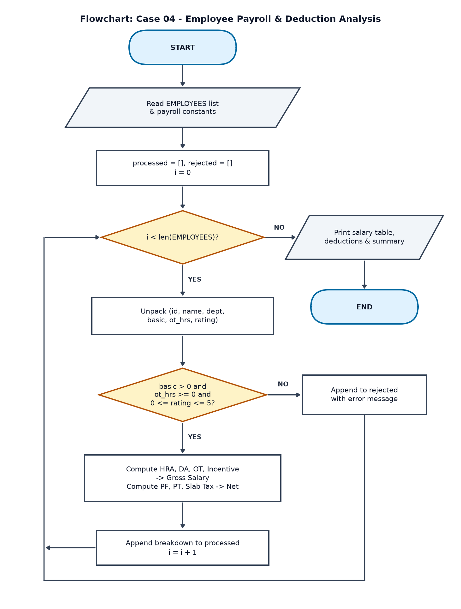

# Case Study 04 — Employee Payroll and Deduction Analysis

**Student:** Mareedu Paardhiv | **Roll No:** 26000626

**Syllabus Topics:** Variables, operators, progressive slabs, conditionals, tuples, unpacking

## 1. Problem Statement

Calculate gross salary from basic pay, allowances, overtime, and incentives; apply progressive deductions and generate a formatted salary statement.

## 2. Objectives

- Represent employee payroll records cleanly using lists of tuples and tuple unpacking.
- Compute component-wise allowances (HRA, DA, Medical), overtime wages, and rating-based incentives.
- Implement progressive monthly income tax slabs along with Provident Fund and Professional Tax deductions.
- Validate input pay, overtime hours, and rating bounds while formatting a readable payroll statement.

## 3. Assumptions

- HRA is 20% of basic pay, DA is 12% of basic pay, and Medical Allowance is fixed at Rs. 1,500 per month.
- Overtime is paid at Rs. 250 per extra hour; ratings >= 4.5 earn Rs. 5,000 incentive, >= 3.5 earn Rs. 2,500, and below 3.5 earn Rs. 0.
- PF is 12% of basic pay; Professional Tax is Rs. 200 when gross salary exceeds Rs. 25,000.
- Monthly income tax is progressive: 0% up to Rs. 30,000, 10% on Rs. 30,001-60,000, and 20% above Rs. 60,000.
- Records with non-positive basic pay, negative overtime, or out-of-range ratings (0-5) are rejected; all data is hypothetical.

## 4. Algorithm

```text
1. START
2. Initialize payroll rate variables (hra_rate, da_rate, medical, ot_rate, pf_rate) and the employees tuple list.
3. Create empty lists processed and rejected.
4. Loop through each employee tuple and unpack (emp_id, name, dept, basic, ot_hours, rating).
5. Validate basic > 0, ot_hours >= 0, and 0 <= rating <= 5. If invalid, append to rejected and continue.
6. Compute hra, da, allowances, ot_pay, and incentive using conditional statements, then sum them with basic to get gross.
7. Compute pf, prof_tax, and progressive tax using slab thresholds, then calculate net_pay = gross - total_ded.
8. Append the computed salary tuple to processed.
9. Loop through processed to print the formatted payroll statement, track totals, and find the highest net earner.
10. Print the deduction breakdown, highest earner, skipped records, and final count.
11. END
```

## 5. Flowchart



## 6. Pseudocode

```text
BEGIN EMPLOYEE_PAYROLL
    SET hra_rate <- 0.20, da_rate <- 0.12, medical <- 1500
    SET ot_rate <- 250, pf_rate <- 0.12
    SET processed <- [], rejected <- []

    FOR EACH emp IN employees DO
        UNPACK (emp_id, name, dept, basic, ot_hours, rating) <- emp
        IF basic <= 0 OR ot_hours < 0 OR rating < 0 OR rating > 5 THEN
            APPEND (emp_id, name, "Invalid input") TO rejected
            CONTINUE
        END IF

        allowances <- (basic * hra_rate) + (basic * da_rate) + medical
        ot_pay <- ot_hours * ot_rate
        IF rating >= 4.5 THEN incentive <- 5000
        ELSE IF rating >= 3.5 THEN incentive <- 2500
        ELSE incentive <- 0

        gross <- basic + allowances + ot_pay + incentive
        pf <- basic * pf_rate
        IF gross > 25000 THEN prof_tax <- 200 ELSE prof_tax <- 0

        IF gross <= 30000 THEN tax <- 0
        ELSE IF gross <= 60000 THEN tax <- (gross - 30000) * 0.10
        ELSE tax <- 3000 + (gross - 60000) * 0.20

        total_ded <- pf + prof_tax + tax
        net_pay <- gross - total_ded
        APPEND salary summary tuple TO processed
    END FOR

    PRINT formatted payroll table, deduction summary, highest earner, and skipped records
END
```

## 7. Python Source Code

```python
"""
Case Study 04: Employee Payroll and Deduction Analysis
Name: Mareedu Paardhiv | Roll No: 26000626
"""

# Monthly allowance and deduction rates
hra_rate = 0.20          # 20% of basic pay
da_rate = 0.12           # 12% of basic pay
medical = 1500.0         # fixed medical allowance
ot_rate = 250.0          # Rs. 250 per overtime hour
pf_rate = 0.12           # 12% Provident Fund on basic pay

# Employee records: (emp_id, name, department, basic_pay, overtime_hours, rating)
employees = [
    ("E101", "Arjun Reddy", "Engineering", 45000.0, 8, 4.7),
    ("E102", "Sneha Rao", "Finance", 38000.0, 4, 4.1),
    ("E103", "Karthik Varma", "Operations", 22000.0, 10, 3.2),
    ("E104", "Divya Nair", "Engineering", 58000.0, 6, 4.8),
    ("E105", "Pranav Sharma", "HR", 28000.0, 0, 3.8),
    ("E106", "Tejaswini K", "Marketing", 32000.0, 12, 4.5),
    ("E107", "Invalid Record", "Support", -15000.0, 3, 3.0),
]

processed = []
rejected = []

for emp in employees:
    emp_id, name, dept, basic, ot_hours, rating = emp

    # Validate input values
    if basic <= 0 or ot_hours < 0 or rating < 0 or rating > 5:
        rejected.append((emp_id, name, "Invalid pay, overtime, or rating"))
        continue

    # Calculate earnings
    hra = basic * hra_rate
    da = basic * da_rate
    allowances = hra + da + medical
    ot_pay = ot_hours * ot_rate

    if rating >= 4.5:
        incentive = 5000.0
    elif rating >= 3.5:
        incentive = 2500.0
    else:
        incentive = 0.0

    gross = basic + allowances + ot_pay + incentive

    # Calculate progressive deductions
    pf = basic * pf_rate
    if gross > 25000.0:
        prof_tax = 200.0
    else:
        prof_tax = 0.0

    # Progressive tax slabs: 0-30k (0%), 30k-60k (10%), above 60k (20%)
    if gross <= 30000.0:
        tax = 0.0
    elif gross <= 60000.0:
        tax = (gross - 30000.0) * 0.10
    else:
        tax = (30000.0 * 0.10) + ((gross - 60000.0) * 0.20)

    total_ded = pf + prof_tax + tax
    net_pay = gross - total_ded

    processed.append((
        emp_id, name, dept, basic, allowances,
        ot_pay + incentive, gross, pf, prof_tax, tax, total_ded, net_pay
    ))

# Display formatted payroll statement
print("=" * 96)
print("                         MONTHLY EMPLOYEE PAYROLL STATEMENT")
print("=" * 96)
print(f"{'ID':<6} {'Name':<15} {'Dept':<12} {'Basic':>9} {'Allow.':>9} {'OT+Inc':>9} "
      f"{'Gross':>10} {'Deduct.':>9} {'Net Pay':>10}")
print("-" * 96)

total_gross = 0.0
total_deductions = 0.0
total_net = 0.0
highest_id = ""
highest_name = ""
highest_net = -1.0

for row in processed:
    emp_id, name, dept, basic, allow, extra, gross, pf, pt, tax, ded, net = row
    print(f"{emp_id:<6} {name:<15} {dept:<12} {basic:>9.2f} {allow:>9.2f} "
          f"{extra:>9.2f} {gross:>10.2f} {ded:>9.2f} {net:>10.2f}")

    total_gross = total_gross + gross
    total_deductions = total_deductions + ded
    total_net = total_net + net

    if net > highest_net:
        highest_net = net
        highest_id = emp_id
        highest_name = name

print("-" * 96)
print(f"{'TOTAL':<65} {total_gross:>10.2f} {total_deductions:>9.2f} {total_net:>10.2f}")
print("=" * 96)

print("\nDEDUCTION BREAKDOWN (PF / Prof. Tax / Income Tax):")
for row in processed:
    emp_id, name, dept, basic, allow, extra, gross, pf, pt, tax, ded, net = row
    print(f"  {emp_id} ({name:<14}): PF = Rs.{pf:>7.2f} | PT = Rs.{pt:>6.2f} | "
          f"Tax = Rs.{tax:>7.2f} | Total = Rs.{ded:>8.2f}")

if highest_name != "":
    print(f"\nHighest Net Salary: {highest_name} ({highest_id}) - Rs. {highest_net:.2f}")

if len(rejected) > 0:
    print("\nSKIPPED / INVALID RECORDS:")
    for emp_id, name, reason in rejected:
        print(f"  {emp_id} ({name}): {reason}")

print(f"\nSummary: {len(processed)} valid records processed, {len(rejected)} invalid skipped.")
```

## 8. Test Cases

| Test ID | Scenario | Expected Result | Status |
| :--- | :--- | :--- | :--- |
| TC-01 | E101 (Arjun Reddy) salary breakdown | Gross Rs. 67,900; Deductions Rs. 10,180; Net Rs. 57,720 | PASS |
| TC-02 | E102 progressive 10% tax slab | Gross Rs. 55,160; Income tax Rs. 2,516; Net Rs. 47,884 | PASS |
| TC-03 | Highest net salary earner | Identifies Divya Nair (E104) with Rs. 69,488.00 | PASS |
| TC-04 | Company payroll totals | Gross Rs. 3,33,360; Deductions Rs. 46,542; Net Rs. 2,86,818 | PASS |
| TC-05 | Negative basic pay (E107) | Rejected cleanly; 6 valid processed, 1 invalid skipped | PASS |

Run automated tests: `python3 Case_04_Employee_Payroll/test_cases.py`

## 9. Output & Output Screenshot


<details>
<summary>View raw console output (output.txt)</summary>

```text
================================================================================================
                         MONTHLY EMPLOYEE PAYROLL STATEMENT
================================================================================================
ID     Name            Dept             Basic    Allow.    OT+Inc      Gross   Deduct.    Net Pay
------------------------------------------------------------------------------------------------
E101   Arjun Reddy     Engineering   45000.00  15900.00   7000.00   67900.00  10180.00   57720.00
E102   Sneha Rao       Finance       38000.00  13660.00   3500.00   55160.00   7276.00   47884.00
E103   Karthik Varma   Operations    22000.00   8540.00   2500.00   33040.00   3144.00   29896.00
E104   Divya Nair      Engineering   58000.00  20060.00   6500.00   84560.00  15072.00   69488.00
E105   Pranav Sharma   HR            28000.00  10460.00   2500.00   40960.00   4656.00   36304.00
E106   Tejaswini K     Marketing     32000.00  11740.00   8000.00   51740.00   6214.00   45526.00
------------------------------------------------------------------------------------------------
TOTAL                                                              333360.00  46542.00  286818.00
================================================================================================

DEDUCTION BREAKDOWN (PF / Prof. Tax / Income Tax):
  E101 (Arjun Reddy   ): PF = Rs.5400.00 | PT = Rs.200.00 | Tax = Rs.4580.00 | Total = Rs.10180.00
  E102 (Sneha Rao     ): PF = Rs.4560.00 | PT = Rs.200.00 | Tax = Rs.2516.00 | Total = Rs. 7276.00
  E103 (Karthik Varma ): PF = Rs.2640.00 | PT = Rs.200.00 | Tax = Rs. 304.00 | Total = Rs. 3144.00
  E104 (Divya Nair    ): PF = Rs.6960.00 | PT = Rs.200.00 | Tax = Rs.7912.00 | Total = Rs.15072.00
  E105 (Pranav Sharma ): PF = Rs.3360.00 | PT = Rs.200.00 | Tax = Rs.1096.00 | Total = Rs. 4656.00
  E106 (Tejaswini K   ): PF = Rs.3840.00 | PT = Rs.200.00 | Tax = Rs.2174.00 | Total = Rs. 6214.00

Highest Net Salary: Divya Nair (E104) - Rs. 69488.00

SKIPPED / INVALID RECORDS:
  E107 (Invalid Record): Invalid pay, overtime, or rating

Summary: 6 valid records processed, 1 invalid skipped.
```

</details>

## 10. Conclusion

The payroll script processes allowances, overtime, performance incentives, and multi-slab tax deductions using beginner-level variables, conditional blocks, loops, tuples, and tuple unpacking. Invalid records are isolated before calculation, keeping totals accurate.
