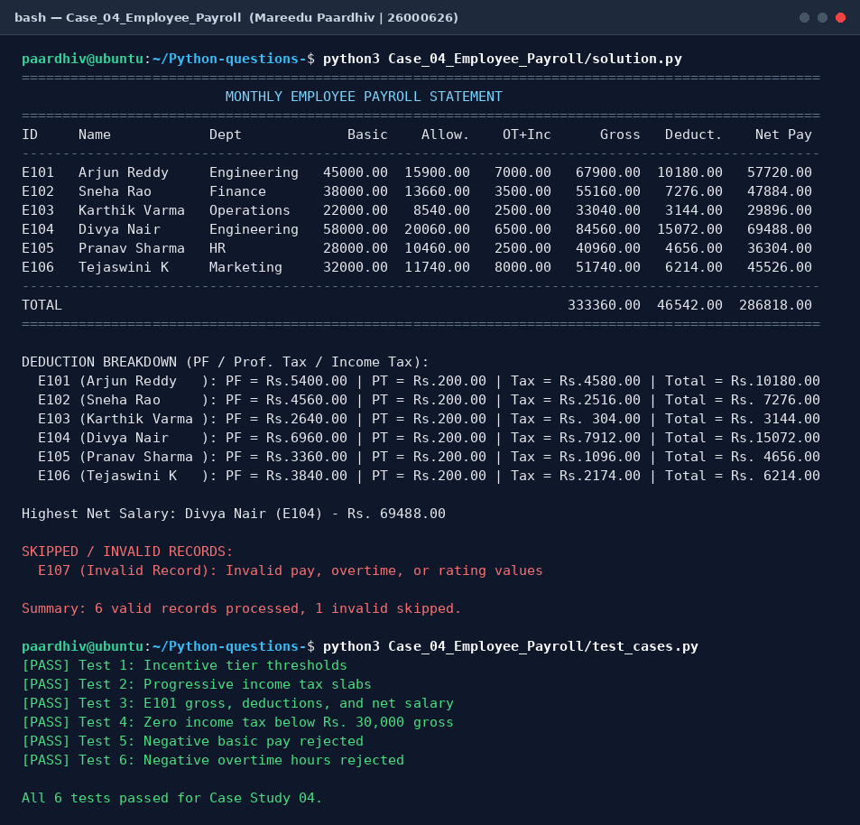

# Case Study 04 — Employee Payroll and Deduction Analysis

**Student:** Mareedu Paardhiv | **Roll No:** 26000626

**Syllabus Topics:** Variables, operators, progressive slabs, conditionals, tuples, unpacking

## 1. Problem Statement

Calculate gross salary from basic pay, allowances, overtime, and incentives; apply progressive deductions and generate a formatted salary statement.

## 2. Objectives

- Represent employee payroll inputs cleanly using lists of tuples and tuple unpacking.
- Compute component-wise allowances (HRA, DA, Medical), overtime wages, and rating-based incentives.
- Implement progressive monthly income tax slabs along with Provident Fund and Professional Tax deductions.
- Validate input pay, overtime hours, and rating bounds while formatting a readable payroll summary.

## 3. Assumptions

- HRA is 20% of basic pay, DA is 12% of basic pay, and Medical Allowance is fixed at Rs. 1,500 per month.
- Overtime is paid at a flat rate of Rs. 250 per extra hour; ratings >= 4.5 earn Rs. 5,000 incentive, >= 3.5 earn Rs. 2,500, and below 3.5 earn Rs. 0.
- PF is 12% of basic pay; Professional Tax is Rs. 200 when gross salary exceeds Rs. 25,000.
- Monthly income tax is progressive: 0% up to Rs. 30,000, 10% on Rs. 30,001-60,000, and 20% above Rs. 60,000.
- Records with non-positive basic pay, negative overtime, or out-of-range ratings (0-5) are rejected; all data is hypothetical.

## 4. Algorithm

```text
1. START
2. Initialize payroll constants (HRA_RATE, DA_RATE, MEDICAL_ALLOWANCE, OVERTIME_RATE, PF_RATE) and the EMPLOYEES tuple list.
3. Create empty lists `processed` and `rejected`.
4. For each employee tuple, unpack (emp_id, name, dept, basic, ot_hours, rating).
5. Validate basic > 0, ot_hours >= 0, and 0 <= rating <= 5. If invalid, append to `rejected` and continue.
6. Compute allowances = basic * 0.20 + basic * 0.12 + 1500, overtime_pay = ot_hours * 250, and incentive from rating tier.
7. Compute gross = basic + allowances + overtime_pay + incentive.
8. Compute pf = basic * 0.12, prof_tax (200 if gross > 25000 else 0), and progressive income_tax using slab thresholds.
9. Compute net_salary = gross - (pf + prof_tax + income_tax) and append breakdown tuple to `processed`.
10. Print the formatted payroll table, deduction breakdown, highest-paid employee, skipped records, and totals.
11. END
```

## 5. Flowchart


## 6. Pseudocode

```text
BEGIN EMPLOYEE_PAYROLL
    SET HRA_RATE <- 0.20, DA_RATE <- 0.12, MEDICAL <- 1500
    SET OT_RATE <- 250, PF_RATE <- 0.12
    SET processed <- [], rejected <- []

    FOR EACH emp IN EMPLOYEES DO
        UNPACK (emp_id, name, dept, basic, ot_hours, rating) <- emp
        IF basic <= 0 OR ot_hours < 0 OR rating < 0 OR rating > 5 THEN
            APPEND (emp_id, name, "Invalid input") TO rejected
            CONTINUE
        END IF

        allowances <- (basic * HRA_RATE) + (basic * DA_RATE) + MEDICAL
        overtime_pay <- ot_hours * OT_RATE
        IF rating >= 4.5 THEN incentive <- 5000
        ELSE IF rating >= 3.5 THEN incentive <- 2500
        ELSE incentive <- 0

        gross <- basic + allowances + overtime_pay + incentive
        pf <- basic * PF_RATE
        prof_tax <- 200 IF gross > 25000 ELSE 0

        IF gross <= 30000 THEN tax <- 0
        ELSE IF gross <= 60000 THEN tax <- (gross - 30000) * 0.10
        ELSE tax <- 3000 + (gross - 60000) * 0.20

        deductions <- pf + prof_tax + tax
        net_salary <- gross - deductions
        APPEND breakdown tuple TO processed
    END FOR

    PRINT formatted salary table, deduction summary, highest earner, and invalid records
END
```

## 7. Python Source Code

```python
"""
Case Study 04: Employee Payroll and Deduction Analysis
Name: Mareedu Paardhiv | Roll No: 26000626
"""

# Monthly allowance and deduction rates
HRA_RATE = 0.20          # 20% of basic pay
DA_RATE = 0.12           # 12% of basic pay
MEDICAL_ALLOWANCE = 1500.0
OVERTIME_RATE = 250.0    # Rs. 250 per extra hour
PF_RATE = 0.12           # 12% Provident Fund on basic pay

# Employee records: (emp_id, name, department, basic_pay, overtime_hours, rating)
EMPLOYEES = [
    ("E101", "Arjun Reddy", "Engineering", 45000.0, 8, 4.7),
    ("E102", "Sneha Rao", "Finance", 38000.0, 4, 4.1),
    ("E103", "Karthik Varma", "Operations", 22000.0, 10, 3.2),
    ("E104", "Divya Nair", "Engineering", 58000.0, 6, 4.8),
    ("E105", "Pranav Sharma", "HR", 28000.0, 0, 3.8),
    ("E106", "Tejaswini K", "Marketing", 32000.0, 12, 4.5),
    ("E107", "Invalid Record", "Support", -15000.0, 3, 3.0),
]


def compute_incentive(rating):
    if rating >= 4.5:
        return 5000.0
    elif rating >= 3.5:
        return 2500.0
    else:
        return 0.0


def compute_income_tax(gross_salary):
    # Progressive monthly tax slabs:
    # 0 - 30,000: 0%, 30,001 - 60,000: 10%, above 60,000: 20%
    if gross_salary <= 30000.0:
        return 0.0
    elif gross_salary <= 60000.0:
        return (gross_salary - 30000.0) * 0.10
    else:
        return (30000.0 * 0.10) + ((gross_salary - 60000.0) * 0.20)


def process_employee(record):
    emp_id, name, dept, basic, ot_hours, rating = record

    if basic <= 0 or ot_hours < 0 or rating < 0 or rating > 5:
        return (False, emp_id, name, dept, "Invalid pay, overtime, or rating values")

    hra = basic * HRA_RATE
    da = basic * DA_RATE
    allowances = hra + da + MEDICAL_ALLOWANCE
    overtime_pay = ot_hours * OVERTIME_RATE
    incentive = compute_incentive(rating)

    gross = basic + allowances + overtime_pay + incentive

    pf = basic * PF_RATE
    prof_tax = 200.0 if gross > 25000.0 else 0.0
    income_tax = compute_income_tax(gross)
    total_deductions = pf + prof_tax + income_tax
    net_salary = gross - total_deductions

    breakdown = (
        emp_id,
        name,
        dept,
        round(basic, 2),
        round(allowances, 2),
        round(overtime_pay, 2),
        round(incentive, 2),
        round(gross, 2),
        round(pf, 2),
        round(prof_tax, 2),
        round(income_tax, 2),
        round(total_deductions, 2),
        round(net_salary, 2),
    )
    return (True, breakdown)


def main():
    processed = []
    rejected = []

    for emp in EMPLOYEES:
        result = process_employee(emp)
        if result[0]:
            processed.append(result[1])
        else:
            rejected.append((result[1], result[2], result[4]))

    print("=" * 98)
    print("                         MONTHLY EMPLOYEE PAYROLL STATEMENT")
    print("=" * 98)
    print(f"{'ID':<6} {'Name':<15} {'Dept':<12} {'Basic':>9} {'Allow.':>9} {'OT+Inc':>9} "
          f"{'Gross':>10} {'Deduct.':>9} {'Net Pay':>10}")
    print("-" * 98)

    total_gross = 0.0
    total_ded = 0.0
    total_net = 0.0
    highest_emp = None

    for row in processed:
        (emp_id, name, dept, basic, allowances, ot_pay, incentive,
         gross, pf, pt, tax, deductions, net) = row

        extra = ot_pay + incentive
        print(f"{emp_id:<6} {name:<15} {dept:<12} {basic:>9.2f} {allowances:>9.2f} "
              f"{extra:>9.2f} {gross:>10.2f} {deductions:>9.2f} {net:>10.2f}")

        total_gross += gross
        total_ded += deductions
        total_net += net

        if highest_emp is None or net > highest_emp[12]:
            highest_emp = row

    print("-" * 98)
    print(f"{'TOTAL':<35} {'':>9} {'':>9} {'':>9} "
          f"{total_gross:>10.2f} {total_ded:>9.2f} {total_net:>10.2f}")
    print("=" * 98)

    print("\nDEDUCTION BREAKDOWN (PF / Prof. Tax / Income Tax):")
    for row in processed:
        emp_id, name, _, _, _, _, _, _, pf, pt, tax, deductions, _ = row
        print(f"  {emp_id} ({name:<14}): PF = Rs.{pf:>7.2f} | PT = Rs.{pt:>6.2f} | "
              f"Tax = Rs.{tax:>7.2f} | Total = Rs.{deductions:>8.2f}")

    if highest_emp is not None:
        print(f"\nHighest Net Salary: {highest_emp[1]} ({highest_emp[0]}) - Rs. {highest_emp[12]:.2f}")

    if len(rejected) > 0:
        print("\nSKIPPED / INVALID RECORDS:")
        for emp_id, name, reason in rejected:
            print(f"  {emp_id} ({name}): {reason}")

    print(f"\nSummary: {len(processed)} valid records processed, {len(rejected)} invalid skipped.")


if __name__ == "__main__":
    main()
```

## 8. Test Cases

| Test ID | Scenario | Expected Result | Status |
| :--- | :--- | :--- | :--- |
| TC-01 | Incentive tiers (>=4.5, >=3.5, <3.5) | Returns Rs. 5000, Rs. 2500, and Rs. 0 accurately | PASS |
| TC-02 | Progressive tax slabs (28k, 45k, 75k) | Computes Rs. 0, Rs. 1500, and Rs. 6000 tax | PASS |
| TC-03 | Full breakdown for E101 (Arjun Reddy) | Gross Rs. 67,900; Deductions Rs. 10,180; Net Rs. 57,720 | PASS |
| TC-04 | Low gross salary tax exemption | Zero income tax below Rs. 30,000 gross | PASS |
| TC-05 | Negative basic pay (E107) | Rejected cleanly with reason message | PASS |
| TC-06 | Negative overtime hours | Rejected without crashing payroll run | PASS |

Run automated tests: `python3 Case_04_Employee_Payroll/test_cases.py`

## 9. Output & Output Screenshot



<details>
<summary>View raw console output (output.txt)</summary>

```text
==================================================================================================
                         MONTHLY EMPLOYEE PAYROLL STATEMENT
==================================================================================================
ID     Name            Dept             Basic    Allow.    OT+Inc      Gross   Deduct.    Net Pay
--------------------------------------------------------------------------------------------------
E101   Arjun Reddy     Engineering   45000.00  15900.00   7000.00   67900.00  10180.00   57720.00
E102   Sneha Rao       Finance       38000.00  13660.00   3500.00   55160.00   7276.00   47884.00
E103   Karthik Varma   Operations    22000.00   8540.00   2500.00   33040.00   3144.00   29896.00
E104   Divya Nair      Engineering   58000.00  20060.00   6500.00   84560.00  15072.00   69488.00
E105   Pranav Sharma   HR            28000.00  10460.00   2500.00   40960.00   4656.00   36304.00
E106   Tejaswini K     Marketing     32000.00  11740.00   8000.00   51740.00   6214.00   45526.00
--------------------------------------------------------------------------------------------------
TOTAL                                                              333360.00  46542.00  286818.00
==================================================================================================

DEDUCTION BREAKDOWN (PF / Prof. Tax / Income Tax):
  E101 (Arjun Reddy   ): PF = Rs.5400.00 | PT = Rs.200.00 | Tax = Rs.4580.00 | Total = Rs.10180.00
  E102 (Sneha Rao     ): PF = Rs.4560.00 | PT = Rs.200.00 | Tax = Rs.2516.00 | Total = Rs. 7276.00
  E103 (Karthik Varma ): PF = Rs.2640.00 | PT = Rs.200.00 | Tax = Rs. 304.00 | Total = Rs. 3144.00
  E104 (Divya Nair    ): PF = Rs.6960.00 | PT = Rs.200.00 | Tax = Rs.7912.00 | Total = Rs.15072.00
  E105 (Pranav Sharma ): PF = Rs.3360.00 | PT = Rs.200.00 | Tax = Rs.1096.00 | Total = Rs. 4656.00
  E106 (Tejaswini K   ): PF = Rs.3840.00 | PT = Rs.200.00 | Tax = Rs.2174.00 | Total = Rs. 6214.00

Highest Net Salary: Divya Nair (E104) - Rs. 69488.00

SKIPPED / INVALID RECORDS:
  E107 (Invalid Record): Invalid pay, overtime, or rating values

Summary: 6 valid records processed, 1 invalid skipped.
```

</details>

## 10. Conclusion

The payroll module accurately processes allowances, overtime, performance incentives, and multi-slab tax deductions using only variables, conditional branches, loops, tuples, and tuple unpacking. Invalid records are isolated before computation, keeping company totals reliable.
