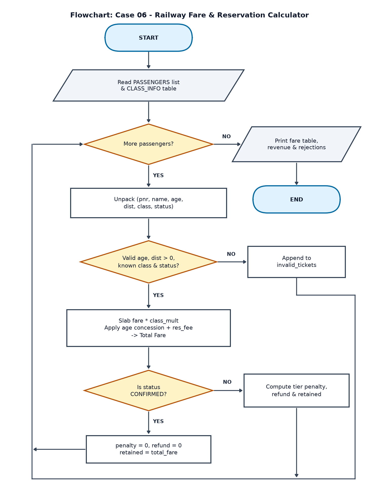
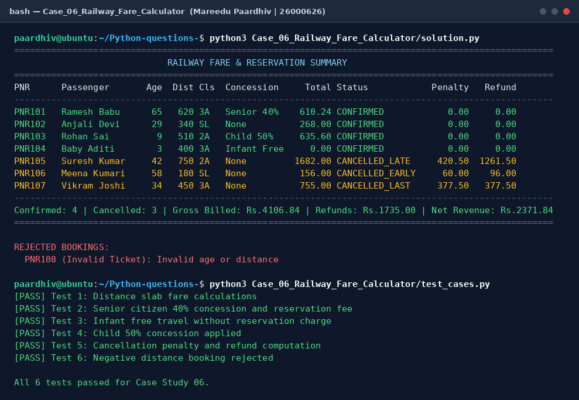

# Case Study 06 — Railway Fare and Reservation Calculator

**Student:** Mareedu Paardhiv | **Roll No:** 26000626

**Syllabus Topics:** Distance slabs, nested conditionals, tuples, lists, concessions, cancellations

## 1. Problem Statement

Calculate fares for multiple passengers using distance slabs, travel classes, age-based concessions, reservation fees, and specified cancellation penalties.

## 2. Objectives

- Calculate progressive distance-based fares across three kilometer slabs.
- Apply class multipliers (SL, 3A, 2A), age-based concessions, and flat reservation fees.
- Evaluate confirmed versus cancelled bookings (early, late, last-minute) to compute penalties and refunds.
- Reject invalid bookings such as negative distance or unknown travel class.

## 3. Assumptions

- Distance rates: Rs. 0.80/km for 0-100 km, Rs. 0.70/km for 101-500 km, and Rs. 0.60/km beyond 500 km.
- Class multipliers & reservation fees: SL (1.0x, Rs. 20), 3A (2.2x, Rs. 40), 2A (3.2x, Rs. 50).
- Concessions on base fare: Infant (<5) travels free with Rs. 0 reservation fee; Child (5-12) gets 50% off; Senior (>=60) gets 40% off.
- Cancellation penalties: Early (>48h) = flat clerkage (SL 60 / 3A 180 / 2A 200); Late (12-48h) = max(clerkage, 25% fare); Last-minute (<12h) = 50% fare.
- Confirmed tickets have Rs. 0 penalty and Rs. 0 refund; net revenue equals total fares retained after refunds.

## 4. Algorithm

```text
1. START
2. Define CLASS_INFO tuple list and PASSENGERS booking list.
3. For each passenger tuple, unpack (pnr, name, age, distance, t_class, status).
4. Validate age >= 0, distance > 0, valid travel class, and valid status. Reject if invalid.
5. Compute base distance fare progressively across 0-100 km, 101-500 km, and >500 km slabs.
6. Multiply by class multiplier, subtract age concession, and add reservation fee (0 if age < 5) to get total_fare.
7. If status is CONFIRMED, set penalty = 0, refund = 0, retained = total_fare.
8. Otherwise apply early, late, or last-minute cancellation rules to calculate penalty, refund, and retained amount.
9. Print formatted passenger summary, revenue totals, and any rejected bookings.
10. END
```

## 5. Flowchart



## 6. Pseudocode

```text
BEGIN RAILWAY_FARE_CALCULATOR
    DEFINE CLASS_INFO <- [("SL", 1.0, 20, 60), ("3A", 2.2, 40, 180), ("2A", 3.2, 50, 200)]

    FOR EACH p IN PASSENGERS DO
        UNPACK (pnr, name, age, dist, cls, status) <- p
        IF age < 0 OR dist <= 0 OR cls NOT FOUND THEN
            APPEND (pnr, name, "Invalid input") TO invalid_tickets
            CONTINUE
        END IF

        slab_fare <- SLAB_RATE(dist)
        base <- slab_fare * class_multiplier
        conc <- CONCESSION_RATE(age)
        total <- (base * (1 - conc)) + (0 IF age < 5 ELSE res_fee)

        IF status = "CONFIRMED" THEN
            penalty <- 0; refund <- 0; retained <- total
        ELSE
            penalty <- CANCELLATION_PENALTY(status, total, clerkage)
            refund <- total - penalty
            retained <- penalty
        END IF
        APPEND ticket summary TO valid_tickets
    END FOR

    PRINT fare table, confirmed/cancelled counts, and net revenue
END
```

## 7. Python Source Code

```python
"""
Case Study 06: Railway Fare and Reservation Calculator
Name: Mareedu Paardhiv | Roll No: 26000626
"""

# Travel class multipliers and flat reservation fees
CLASS_INFO = [
    ("SL", "Sleeper", 1.0, 20.0, 60.0),
    ("3A", "AC 3-Tier", 2.2, 40.0, 180.0),
    ("2A", "AC 2-Tier", 3.2, 50.0, 200.0),
]

# Passenger records:
# (ticket_id, name, age, distance_km, travel_class, booking_status)
# booking_status: CONFIRMED, CANCELLED_EARLY (>48h), CANCELLED_LATE (12-48h), CANCELLED_LAST (<12h)
PASSENGERS = [
    ("PNR101", "Ramesh Babu", 65, 620, "3A", "CONFIRMED"),
    ("PNR102", "Anjali Devi", 29, 340, "SL", "CONFIRMED"),
    ("PNR103", "Rohan Sai", 9, 510, "2A", "CONFIRMED"),
    ("PNR104", "Baby Aditi", 3, 400, "3A", "CONFIRMED"),
    ("PNR105", "Suresh Kumar", 42, 750, "2A", "CANCELLED_LATE"),
    ("PNR106", "Meena Kumari", 58, 180, "SL", "CANCELLED_EARLY"),
    ("PNR107", "Vikram Joshi", 34, 450, "3A", "CANCELLED_LAST"),
    ("PNR108", "Invalid Ticket", 25, -50, "SL", "CONFIRMED"),
]


def get_class_details(code):
    for item in CLASS_INFO:
        c_code, c_name, mult, res_fee, clerkage = item
        if c_code == code:
            return item
    return None


def calculate_distance_base(distance):
    # Slabs: 0-100 km @ 0.80, 101-500 km @ 0.70, >500 km @ 0.60
    if distance <= 100:
        return distance * 0.80
    elif distance <= 500:
        return (100 * 0.80) + ((distance - 100) * 0.70)
    else:
        return (100 * 0.80) + (400 * 0.70) + ((distance - 500) * 0.60)


def get_concession_rate(age):
    if age < 5:
        return 1.00, "Infant Free"
    elif age <= 12:
        return 0.50, "Child 50%"
    elif age >= 60:
        return 0.40, "Senior 40%"
    else:
        return 0.00, "None"


def compute_ticket(passenger):
    pnr, name, age, distance, t_class, status = passenger

    if age < 0 or distance <= 0:
        return (False, pnr, name, "Invalid age or distance")

    cls_details = get_class_details(t_class)
    if cls_details is None:
        return (False, pnr, name, "Unknown travel class")

    _, class_name, multiplier, res_fee, clerkage = cls_details

    base_fare = calculate_distance_base(distance) * multiplier
    conc_rate, conc_label = get_concession_rate(age)
    concession_amt = base_fare * conc_rate
    discounted_fare = base_fare - concession_amt

    applied_res_fee = 0.0 if age < 5 else res_fee
    total_fare = round(discounted_fare + applied_res_fee, 2)

    if status == "CONFIRMED":
        penalty = 0.0
        refund = 0.0
        net_retained = total_fare
    elif status == "CANCELLED_EARLY":
        penalty = min(total_fare, clerkage)
        refund = round(total_fare - penalty, 2)
        net_retained = penalty
    elif status == "CANCELLED_LATE":
        penalty = max(clerkage, round(total_fare * 0.25, 2))
        penalty = min(total_fare, penalty)
        refund = round(total_fare - penalty, 2)
        net_retained = penalty
    elif status == "CANCELLED_LAST":
        penalty = round(total_fare * 0.50, 2)
        refund = round(total_fare - penalty, 2)
        net_retained = penalty
    else:
        return (False, pnr, name, "Unknown booking status")

    return (
        True,
        (
            pnr,
            name,
            age,
            distance,
            t_class,
            conc_label,
            round(base_fare, 2),
            applied_res_fee,
            total_fare,
            status,
            penalty,
            refund,
            net_retained,
        ),
    )


def main():
    valid_tickets = []
    invalid_tickets = []

    for p in PASSENGERS:
        res = compute_ticket(p)
        if res[0]:
            valid_tickets.append(res[1])
        else:
            invalid_tickets.append((res[1], res[2], res[3]))

    print("=" * 102)
    print("                             RAILWAY FARE & RESERVATION SUMMARY")
    print("=" * 102)
    print(f"{'PNR':<8} {'Passenger':<15} {'Age':>3} {'Dist':>5} {'Cls':<4} {'Concession':<11} "
          f"{'Total':>8} {'Status':<16} {'Penalty':>8} {'Refund':>8}")
    print("-" * 102)

    gross_billed = 0.0
    total_refunds = 0.0
    net_revenue = 0.0
    confirmed_count = 0
    cancelled_count = 0

    for t in valid_tickets:
        (pnr, name, age, dist, t_cls, conc_lbl, base_f, res_f,
         total_f, status, penalty, refund, retained) = t

        print(f"{pnr:<8} {name:<15} {age:>3} {dist:>5} {t_cls:<4} {conc_lbl:<11} "
              f"{total_f:>8.2f} {status:<16} {penalty:>8.2f} {refund:>8.2f}")

        gross_billed += total_f
        total_refunds += refund
        net_revenue += retained
        if status == "CONFIRMED":
            confirmed_count += 1
        else:
            cancelled_count += 1

    print("-" * 102)
    print(f"Confirmed: {confirmed_count} | Cancelled: {cancelled_count} | "
          f"Gross Billed: Rs.{gross_billed:.2f} | Refunds: Rs.{total_refunds:.2f} | "
          f"Net Revenue: Rs.{net_revenue:.2f}")
    print("=" * 102)

    if len(invalid_tickets) > 0:
        print("\nREJECTED BOOKINGS:")
        for pnr, name, reason in invalid_tickets:
            print(f"  {pnr} ({name}): {reason}")


if __name__ == "__main__":
    main()
```

## 8. Test Cases

| Test ID | Scenario | Expected Result | Status |
| :--- | :--- | :--- | :--- |
| TC-01 | Distance slab fare for 80, 300, 600 km | Produces Rs. 64.00, Rs. 220.00, and Rs. 420.00 | PASS |
| TC-02 | Senior citizen 40% concession in 3A (PNR101) | Total Rs. 610.24; Confirmed refund Rs. 0.00 | PASS |
| TC-03 | Infant (<5) free ticket (PNR104) | Total fare and reservation fee both Rs. 0.00 | PASS |
| TC-04 | Child 50% concession (PNR103) | Concession label 'Child 50%' and halved base fare | PASS |
| TC-05 | Cancellation tiers (Early & Late) | Early SL clerkage Rs. 60; Late 25% penalty + refund | PASS |
| TC-06 | Negative distance booking (PNR108) | Rejected cleanly with error message | PASS |

Run automated tests: `python3 Case_06_Railway_Fare_Calculator/test_cases.py`

## 9. Output & Output Screenshot



<details>
<summary>View raw console output (output.txt)</summary>

```text
======================================================================================================
                             RAILWAY FARE & RESERVATION SUMMARY
======================================================================================================
PNR      Passenger       Age  Dist Cls  Concession     Total Status            Penalty   Refund
------------------------------------------------------------------------------------------------------
PNR101   Ramesh Babu      65   620 3A   Senior 40%    610.24 CONFIRMED            0.00     0.00
PNR102   Anjali Devi      29   340 SL   None          268.00 CONFIRMED            0.00     0.00
PNR103   Rohan Sai         9   510 2A   Child 50%     635.60 CONFIRMED            0.00     0.00
PNR104   Baby Aditi        3   400 3A   Infant Free     0.00 CONFIRMED            0.00     0.00
PNR105   Suresh Kumar     42   750 2A   None         1682.00 CANCELLED_LATE     420.50  1261.50
PNR106   Meena Kumari     58   180 SL   None          156.00 CANCELLED_EARLY     60.00    96.00
PNR107   Vikram Joshi     34   450 3A   None          755.00 CANCELLED_LAST     377.50   377.50
------------------------------------------------------------------------------------------------------
Confirmed: 4 | Cancelled: 3 | Gross Billed: Rs.4106.84 | Refunds: Rs.1735.00 | Net Revenue: Rs.2371.84
======================================================================================================

REJECTED BOOKINGS:
  PNR108 (Invalid Ticket): Invalid age or distance
```

</details>

## 10. Conclusion

The calculator models multi-slab railway pricing, passenger concessions, and tiered cancellation refunds accurately using lists, tuples, conditional logic, and loops. Confirmed and cancelled revenues reconcile cleanly against gross billing.
