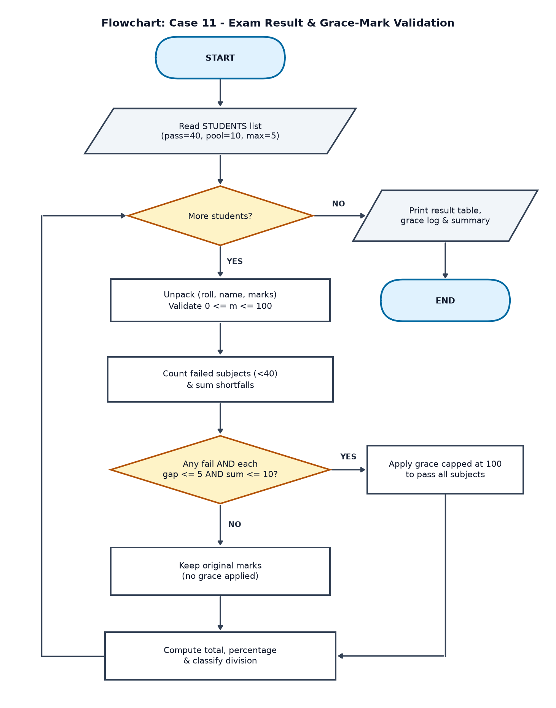

# Case Study 11 — Examination Result and Grace-Mark Validation

**Student:** Mareedu Paardhiv | **Roll No:** 26000626

**Syllabus Topics:** Lists, nested loops, boundary checks, conditional policy, classification

## 1. Problem Statement

Process marks across multiple subjects, apply subject-wise pass criteria and a specified grace-mark policy, and generate final classifications without exceeding maximum marks.

## 2. Objectives

- Validate each student's subject marks against the valid score range (0 to 100).
- Identify subjects below the pass threshold (40 marks) and measure per-subject shortfalls.
- Award grace marks strictly when individual gaps <= 5 and total required grace <= 10 saves the student.
- Classify passing students into Distinction, First, Second, or Pass Class without exceeding 100 marks.

## 3. Assumptions

- There are 5 subjects (Maths, Physics, Python, Digital Logic, English), each out of 100 marks; pass mark is 40.
- Grace pool is up to 10 marks total per student, with at most 5 grace marks allowed in any single subject.
- All-or-nothing policy: grace marks are applied only if they enable the student to pass all 5 subjects.
- Divisions for passing students: >=75% Distinction, 60-74.99% First Class, 50-59.99% Second Class, 40-49.99% Pass Class.

## 4. Algorithm

```text
1. START
2. Define subjects, max_marks = 100, pass_marks = 40, max_grace_pool = 10, and max_grace_per_subject = 5.
3. For each student tuple (roll, name, marks), verify length == 5 and all marks are within 0..100.
4. Scan subject marks to find any score < 40 and sum gap = 40 - m; check if any gap > 5 or total_needed > 10.
5. Copy original marks into final_marks.
6. If failed subjects exist and grace saves all subjects, add the shortfall to each failed subject capped at 100.
7. Re-check failed subjects, compute total_score and pct, and classify into Distinction, First, Second, Pass, or Fail.
8. Print original vs final marks table, grace allocation log, invalid records, and summary counts.
9. END
```

## 5. Flowchart



## 6. Pseudocode

```text
BEGIN EXAM_GRACE_VALIDATION
    SET pass_marks <- 40, max_marks <- 100, pool <- 10, per_sub <- 5

    FOR EACH stu IN students DO
        UNPACK (roll, name, marks) <- stu
        IF ANY mark < 0 OR mark > max_marks THEN
            APPEND to invalid; CONTINUE
        END IF

        total_needed <- 0; can_save <- TRUE
        FOR EACH m IN marks DO
            IF m < pass_marks THEN
                gap <- pass_marks - m
                total_needed <- total_needed + gap
                IF gap > per_sub THEN can_save <- FALSE
            END IF
        END FOR
        IF total_needed > pool THEN can_save <- FALSE

        final_marks <- COPY(marks)
        IF total_needed > 0 AND can_save THEN
            FOR i <- 0 TO LENGTH(final_marks) - 1 DO
                IF final_marks[i] < pass_marks THEN
                    final_marks[i] <- MIN(max_marks, pass_marks)
                END IF
            END FOR
        END IF

        COMPUTE percentage and classify Distinction / First / Second / Pass / Fail
    END FOR
    PRINT result table and grace details
END
```

## 7. Python Source Code

```python
"""
Case Study 11: Examination Result and Grace-Mark Validation
Name: Mareedu Paardhiv | Roll No: 26000626
"""

subjects = ["Maths", "Physics", "Python", "Digital Logic", "English"]
max_marks = 100
pass_marks = 40
max_grace_pool = 10
max_grace_per_subject = 5

# Student records: (roll_no, name, marks_list)
students = [
    ("26B01", "Nikhil Varma", [84, 79, 91, 76, 82]),
    ("26B02", "Bhavana Rao", [37, 65, 72, 38, 60]),    # needs 3 + 2 = 5 grace -> PASS
    ("26B03", "Charan Teja", [35, 36, 37, 68, 70]),    # needs 12 > 10 -> FAIL
    ("26B04", "Keerthi S", [32, 74, 81, 69, 77]),      # Maths 32 needs 8 > 5 -> FAIL
    ("26B05", "Prashanth K", [42, 41, 44, 40, 43]),    # Pass Class
    ("26B06", "Swathi Reddy", [98, 95, 99, 92, 94]),   # Distinction
    ("26B07", "Manoj Kumar", [54, 58, 36, 52, 61]),    # needs 4 in Python -> PASS
    ("26B08", "Bad Data", [50, 105, 60, 70, 80]),      # invalid (>100)
]

results = []
invalid = []

for stu in students:
    roll, name, marks = stu

    # Validate subject count and mark boundaries (0..100)
    if len(marks) != len(subjects):
        invalid.append((roll, name, "Subject count mismatch"))
        continue

    bad_mark = False
    bad_val = 0
    for m in marks:
        if m < 0 or m > max_marks:
            bad_mark = True
            bad_val = m
            break

    if bad_mark:
        invalid.append((roll, name, f"Mark {bad_val} out of valid range 0..{max_marks}"))
        continue

    # Check failed subjects and grace-mark eligibility
    total_needed = 0
    can_save = True
    for m in marks:
        if m < pass_marks:
            gap = pass_marks - m
            total_needed = total_needed + gap
            if gap > max_grace_per_subject:
                can_save = False

    if total_needed > max_grace_pool:
        can_save = False

    final_marks = []
    grace_used = []
    for m in marks:
        final_marks.append(m)
        grace_used.append(0)

    grace_applied = 0
    if total_needed > 0 and can_save:
        for i in range(len(final_marks)):
            if final_marks[i] < pass_marks:
                gap = pass_marks - final_marks[i]
                updated = final_marks[i] + gap
                if updated > max_marks:
                    updated = max_marks
                grace_used[i] = updated - final_marks[i]
                final_marks[i] = updated
                grace_applied = grace_applied + grace_used[i]

    # Check final failed subjects and calculate division
    failed_subjects = []
    for i in range(len(final_marks)):
        if final_marks[i] < pass_marks:
            failed_subjects.append(f"{subjects[i]}({final_marks[i]})")

    total_score = 0
    for m in final_marks:
        total_score = total_score + m

    pct = round((total_score / (len(subjects) * max_marks)) * 100.0, 2)

    if len(failed_subjects) > 0:
        division = "Fail"
    elif pct >= 75.0:
        division = "Distinction"
    elif pct >= 60.0:
        division = "First Class"
    elif pct >= 50.0:
        division = "Second Class"
    else:
        division = "Pass Class"

    results.append((roll, name, marks, final_marks, grace_used, grace_applied,
                    total_score, pct, division, failed_subjects))

print("=" * 96)
print("                    EXAMINATION RESULT & GRACE-MARK VALIDATION REPORT")
print("=" * 96)
print(f"{'Roll':<7} {'Name':<14} {'Original Marks':<21} {'Final Marks':<21} "
      f"{'Grace':>5} {'Total':>5} {'Pct%':>6}  {'Result'}")
print("-" * 96)

pass_count = 0
grace_count = 0

for row in results:
    roll, name, orig, final, g_used, g_total, tot, pct, div, failed = row

    orig_str = ""
    final_str = ""
    for i in range(len(orig)):
        orig_str = orig_str + f"{orig[i]:>3} "
        final_str = final_str + f"{final[i]:>3} "

    print(f"{roll:<7} {name:<14} {orig_str:<21} {final_str:<21} "
          f"{g_total:>5} {tot:>5} {pct:>6.2f}  {div}")

    if div != "Fail":
        pass_count = pass_count + 1
    if g_total > 0:
        grace_count = grace_count + 1

print("-" * 96)
print("\nGRACE-MARK & FAILURE DETAILS:")
for row in results:
    roll, name, orig, final, g_used, g_total, tot, pct, div, failed = row
    if g_total > 0:
        details = []
        for i in range(len(subjects)):
            if g_used[i] > 0:
                details.append(f"{subjects[i]} +{g_used[i]} ({orig[i]}->{final[i]})")
        print(f"  {roll} ({name}): Grace applied -> {', '.join(details)}")
    elif len(failed) > 0:
        print(f"  {roll} ({name}): Grace not eligible -> Failed in {', '.join(failed)}")

if len(invalid) > 0:
    print("\nINVALID INPUT RECORDS:")
    for roll, name, msg in invalid:
        print(f"  {roll} ({name}): {msg}")

print("-" * 96)
print(f"Summary: {pass_count} Passed ({grace_count} via grace), "
      f"{len(results) - pass_count} Failed, {len(invalid)} Invalid.")
```

## 8. Test Cases

| Test ID | Scenario | Expected Result | Status |
| :--- | :--- | :--- | :--- |
| TC-01 | High scorer without grace (26B01) | Zero grace applied; classified as Distinction | PASS |
| TC-02 | Two borderline subjects (26B02: 37, 38) | Receives +3 and +2 = 5 grace; passes as Second Class | PASS |
| TC-03 | Pool exceeded (26B03: needs 12 > 10) | Grace withheld; remains Fail with failed subjects listed | PASS |
| TC-04 | Single subject cap exceeded (26B04: 32 needs 8 > 5) | Grace withheld; remains Fail | PASS |
| TC-05 | Out-of-range mark 105 (26B08) & summary | Rejected before result processing; 5 Passed, 2 Failed | PASS |

Run automated tests: `python3 Case_11_Exam_Grace_Marks/test_cases.py`

## 9. Output & Output Screenshot


<details>
<summary>View raw console output (output.txt)</summary>

```text
================================================================================================
                    EXAMINATION RESULT & GRACE-MARK VALIDATION REPORT
================================================================================================
Roll    Name           Original Marks        Final Marks           Grace Total   Pct%  Result
------------------------------------------------------------------------------------------------
26B01   Nikhil Varma    84  79  91  76  82    84  79  91  76  82       0   412  82.40  Distinction
26B02   Bhavana Rao     37  65  72  38  60    40  65  72  40  60       5   277  55.40  Second Class
26B03   Charan Teja     35  36  37  68  70    35  36  37  68  70       0   246  49.20  Fail
26B04   Keerthi S       32  74  81  69  77    32  74  81  69  77       0   333  66.60  Fail
26B05   Prashanth K     42  41  44  40  43    42  41  44  40  43       0   210  42.00  Pass Class
26B06   Swathi Reddy    98  95  99  92  94    98  95  99  92  94       0   478  95.60  Distinction
26B07   Manoj Kumar     54  58  36  52  61    54  58  40  52  61       4   265  53.00  Second Class
------------------------------------------------------------------------------------------------

GRACE-MARK & FAILURE DETAILS:
  26B02 (Bhavana Rao): Grace applied -> Maths +3 (37->40), Digital Logic +2 (38->40)
  26B03 (Charan Teja): Grace not eligible -> Failed in Maths(35), Physics(36), Python(37)
  26B04 (Keerthi S): Grace not eligible -> Failed in Maths(32)
  26B07 (Manoj Kumar): Grace applied -> Python +4 (36->40)

INVALID INPUT RECORDS:
  26B08 (Bad Data): Mark 105 out of valid range 0..100
------------------------------------------------------------------------------------------------
Summary: 5 Passed (2 via grace), 2 Failed, 1 Invalid.
```

</details>

## 10. Conclusion

The script applies exam grace rules consistently using loops, lists, and conditional checks while preventing invalid scores (>100) from entering final classifications.
