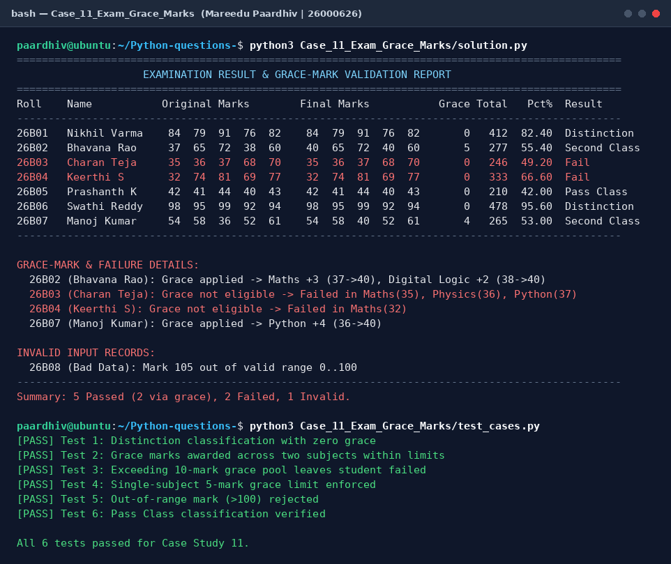

# Case Study 11 — Examination Result and Grace-Mark Validation

**Student:** Mareedu Paardhiv | **Roll No:** 26000626

**Syllabus Topics:** Lists, nested loops, boundary checks, conditional policy, classification

## 1. Problem Statement

Process marks across multiple subjects, apply subject-wise pass criteria and a specified grace-mark policy, and generate final classifications without exceeding maximum marks.

## 2. Objectives

- Validate each student's subject marks against the valid score range (0 to 100).
- Identify subjects below the pass threshold (40 marks) and measure per-subject shortfalls.
- Award grace marks strictly when individual gaps <= 5 and total required grace <= 10 saves the student.
- Classify passing students into Distinction, First, Second, or Pass Class without exceeding 100 marks.

## 3. Assumptions

- There are 5 subjects (Maths, Physics, Python, Digital Logic, English), each out of 100 marks; pass mark is 40.
- Grace pool is up to 10 marks total per student, with at most 5 grace marks allowed in any single subject.
- All-or-nothing policy: grace marks are applied only if they make the student pass all 5 subjects.
- Divisions for passing students: >=75% Distinction, 60-74.99% First Class, 50-59.99% Second Class, 40-49.99% Pass Class.

## 4. Algorithm

```text
1. START
2. Define SUBJECTS, MAX_MARKS = 100, PASS_MARKS = 40, MAX_GRACE_POOL = 10, MAX_GRACE_PER_SUBJECT = 5.
3. For each student tuple (roll, name, marks), check length == 5 and all marks within 0..100.
4. Scan subject marks to collect any subject with mark < 40 and compute shortfall = 40 - mark.
5. Check eligibility: every shortfall <= 5 and sum of shortfalls <= 10.
6. If failed subjects exist and grace makes all subjects pass, add shortfall to each failed subject capped at MAX_MARKS.
7. Re-verify failed subjects, compute final total and percentage, and assign result division.
8. Print original vs final marks table, grace allocation log, invalid records, and summary counts.
9. END
```

## 5. Flowchart


## 6. Pseudocode

```text
BEGIN EXAM_GRACE_VALIDATION
    CONST PASS <- 40, MAX_MARKS <- 100, POOL <- 10, PER_SUB <- 5

    FOR EACH student IN STUDENTS DO
        UNPACK (roll, name, marks) <- student
        IF ANY mark < 0 OR mark > MAX_MARKS THEN
            RECORD invalid_student; CONTINUE
        END IF

        total_needed <- 0; eligible <- TRUE
        FOR i <- 0 TO LENGTH(marks) - 1 DO
            IF marks[i] < PASS THEN
                gap <- PASS - marks[i]
                total_needed <- total_needed + gap
                IF gap > PER_SUB THEN eligible <- FALSE
            END IF
        END FOR
        IF total_needed > POOL THEN eligible <- FALSE

        final_marks <- COPY(marks)
        IF total_needed > 0 AND eligible THEN
            FOR EACH failed subject i DO
                final_marks[i] <- MIN(MAX_MARKS, final_marks[i] + (PASS - final_marks[i]))
            END FOR
        END IF

        Compute percentage and classify Distinction / First / Second / Pass / Fail
    END FOR
    PRINT result table and grace details
END
```

## 7. Python Source Code

```python
"""
Case Study 11: Examination Result and Grace-Mark Validation
Name: Mareedu Paardhiv | Roll No: 26000626
"""

SUBJECTS = ["Maths", "Physics", "Python", "Digital Logic", "English"]
MAX_MARKS = 100
PASS_MARKS = 40
MAX_GRACE_POOL = 10
MAX_GRACE_PER_SUBJECT = 5

# Student records: (roll_no, name, marks_list)
STUDENTS = [
    ("26B01", "Nikhil Varma", [84, 79, 91, 76, 82]),
    ("26B02", "Bhavana Rao", [37, 65, 72, 38, 60]),    # needs 3 + 2 = 5 grace -> PASS
    ("26B03", "Charan Teja", [35, 36, 37, 68, 70]),    # needs 5 + 4 + 3 = 12 > 10 -> FAIL
    ("26B04", "Keerthi S", [32, 74, 81, 69, 77]),      # Maths 32 needs 8 > 5 -> FAIL
    ("26B05", "Prashanth K", [42, 41, 44, 40, 43]),    # just pass -> Pass Class
    ("26B06", "Swathi Reddy", [98, 95, 99, 92, 94]),   # Distinction
    ("26B07", "Manoj Kumar", [54, 58, 36, 52, 61]),    # needs 4 grace in Python -> PASS
    ("26B08", "Bad Data", [50, 105, 60, 70, 80]),      # invalid (>100)
]


def classify_percentage(pct, passed_all):
    if not passed_all:
        return "Fail"
    if pct >= 75.0:
        return "Distinction"
    elif pct >= 60.0:
        return "First Class"
    elif pct >= 50.0:
        return "Second Class"
    else:
        return "Pass Class"


def evaluate_student(student):
    roll, name, marks = student

    if len(marks) != len(SUBJECTS):
        return (False, roll, name, "Subject count mismatch")

    for m in marks:
        if m < 0 or m > MAX_MARKS:
            return (False, roll, name, f"Mark {m} out of valid range 0..{MAX_MARKS}")

    # Check failed subjects and compute grace needed
    needed_list = []
    total_needed = 0
    can_save_with_grace = True

    for i in range(len(marks)):
        if marks[i] < PASS_MARKS:
            shortfall = PASS_MARKS - marks[i]
            needed_list.append((i, shortfall))
            total_needed += shortfall
            if shortfall > MAX_GRACE_PER_SUBJECT:
                can_save_with_grace = False

    if total_needed > MAX_GRACE_POOL:
        can_save_with_grace = False

    final_marks = []
    grace_used = []
    for i in range(len(marks)):
        final_marks.append(marks[i])
        grace_used.append(0)

    grace_applied = 0
    if len(needed_list) > 0 and can_save_with_grace:
        for idx, shortfall in needed_list:
            # Ensure marks never exceed MAX_MARKS
            updated = min(MAX_MARKS, final_marks[idx] + shortfall)
            grace_used[idx] = updated - final_marks[idx]
            final_marks[idx] = updated
            grace_applied += grace_used[idx]

    failed_subjects = []
    for i in range(len(final_marks)):
        if final_marks[i] < PASS_MARKS:
            failed_subjects.append(f"{SUBJECTS[i]}({final_marks[i]})")

    passed_all = (len(failed_subjects) == 0)
    total_score = sum(final_marks)
    percentage = round((total_score / (len(SUBJECTS) * MAX_MARKS)) * 100.0, 2)
    division = classify_percentage(percentage, passed_all)

    return (
        True,
        (
            roll,
            name,
            list(marks),
            final_marks,
            grace_used,
            grace_applied,
            total_score,
            percentage,
            division,
            failed_subjects,
        ),
    )


def main():
    results = []
    invalid = []

    for stu in STUDENTS:
        res = evaluate_student(stu)
        if res[0]:
            results.append(res[1])
        else:
            invalid.append((res[1], res[2], res[3]))

    print("=" * 96)
    print("                    EXAMINATION RESULT & GRACE-MARK VALIDATION REPORT")
    print("=" * 96)
    print(f"{'Roll':<7} {'Name':<14} {'Original Marks':<21} {'Final Marks':<21} "
          f"{'Grace':>5} {'Total':>5} {'Pct%':>6}  {'Result'}")
    print("-" * 96)

    pass_count = 0
    grace_beneficiaries = 0

    for row in results:
        roll, name, orig, final, g_used, g_total, tot, pct, div, failed = row
        orig_str = " ".join(f"{m:>3}" for m in orig)
        final_str = " ".join(f"{m:>3}" for m in final)
        print(f"{roll:<7} {name:<14} {orig_str:<21} {final_str:<21} "
              f"{g_total:>5} {tot:>5} {pct:>6.2f}  {div}")

        if div != "Fail":
            pass_count += 1
        if g_total > 0:
            grace_beneficiaries += 1

    print("-" * 96)
    print("\nGRACE-MARK & FAILURE DETAILS:")
    for row in results:
        roll, name, orig, final, g_used, g_total, tot, pct, div, failed = row
        if g_total > 0:
            details = []
            for i in range(len(SUBJECTS)):
                if g_used[i] > 0:
                    details.append(f"{SUBJECTS[i]} +{g_used[i]} ({orig[i]}->{final[i]})")
            print(f"  {roll} ({name}): Grace applied -> {', '.join(details)}")
        elif len(failed) > 0:
            print(f"  {roll} ({name}): Grace not eligible -> Failed in {', '.join(failed)}")

    if len(invalid) > 0:
        print("\nINVALID INPUT RECORDS:")
        for roll, name, msg in invalid:
            print(f"  {roll} ({name}): {msg}")

    print("-" * 96)
    print(f"Summary: {pass_count} Passed ({grace_beneficiaries} via grace), "
          f"{len(results) - pass_count} Failed, {len(invalid)} Invalid.")


if __name__ == "__main__":
    main()
```

## 8. Test Cases

| Test ID | Scenario | Expected Result | Status |
| :--- | :--- | :--- | :--- |
| TC-01 | High scorer without grace (26B01) | Zero grace applied; classified as Distinction | PASS |
| TC-02 | Two borderline subjects (26B02: 37, 38) | Receives +3 and +2 = 5 grace; passes as Second Class | PASS |
| TC-03 | Pool exceeded (26B03: needs 12 > 10) | Grace withheld; remains Fail with failed subjects listed | PASS |
| TC-04 | Single subject cap exceeded (26B04: 32 needs 8 > 5) | Grace withheld; remains Fail | PASS |
| TC-05 | Out-of-range mark 105 (26B08) | Rejected before result processing | PASS |
| TC-06 | Pass Class lower bound (26B05: 42%) | Classified accurately as Pass Class | PASS |

Run automated tests: `python3 Case_11_Exam_Grace_Marks/test_cases.py`

## 9. Output & Output Screenshot



<details>
<summary>View raw console output (output.txt)</summary>

```text
================================================================================================
                    EXAMINATION RESULT & GRACE-MARK VALIDATION REPORT
================================================================================================
Roll    Name           Original Marks        Final Marks           Grace Total   Pct%  Result
------------------------------------------------------------------------------------------------
26B01   Nikhil Varma    84  79  91  76  82    84  79  91  76  82       0   412  82.40  Distinction
26B02   Bhavana Rao     37  65  72  38  60    40  65  72  40  60       5   277  55.40  Second Class
26B03   Charan Teja     35  36  37  68  70    35  36  37  68  70       0   246  49.20  Fail
26B04   Keerthi S       32  74  81  69  77    32  74  81  69  77       0   333  66.60  Fail
26B05   Prashanth K     42  41  44  40  43    42  41  44  40  43       0   210  42.00  Pass Class
26B06   Swathi Reddy    98  95  99  92  94    98  95  99  92  94       0   478  95.60  Distinction
26B07   Manoj Kumar     54  58  36  52  61    54  58  40  52  61       4   265  53.00  Second Class
------------------------------------------------------------------------------------------------

GRACE-MARK & FAILURE DETAILS:
  26B02 (Bhavana Rao): Grace applied -> Maths +3 (37->40), Digital Logic +2 (38->40)
  26B03 (Charan Teja): Grace not eligible -> Failed in Maths(35), Physics(36), Python(37)
  26B04 (Keerthi S): Grace not eligible -> Failed in Maths(32)
  26B07 (Manoj Kumar): Grace applied -> Python +4 (36->40)

INVALID INPUT RECORDS:
  26B08 (Bad Data): Mark 105 out of valid range 0..100
------------------------------------------------------------------------------------------------
Summary: 5 Passed (2 via grace), 2 Failed, 1 Invalid.
```

</details>

## 10. Conclusion

The program automates exam moderation consistently by checking both per-subject and total grace caps before updating marks. Boundary validation prevents marks above 100 from entering results.
