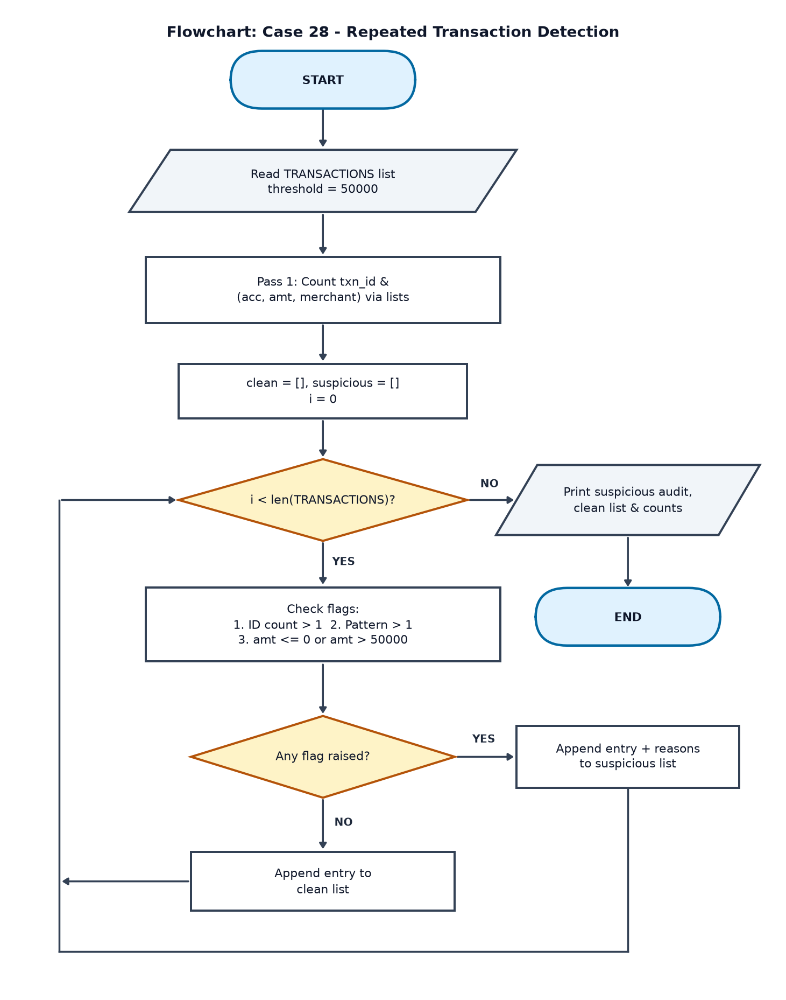
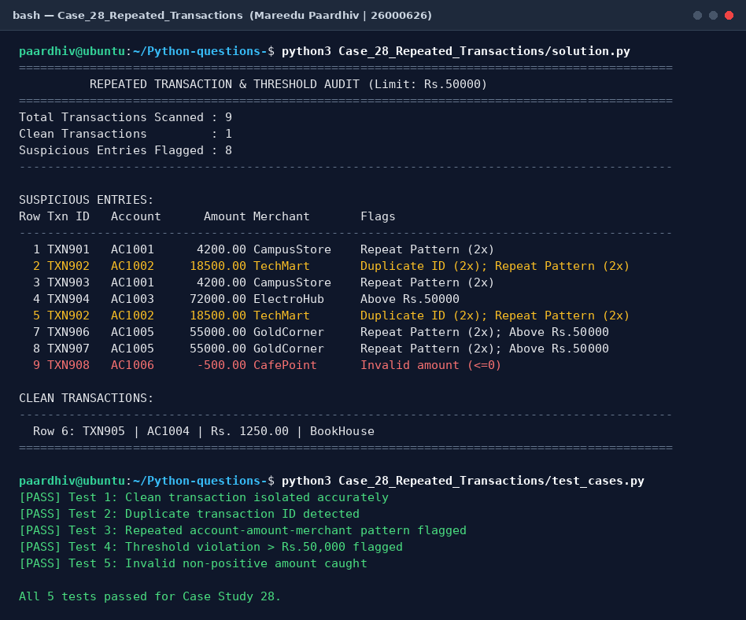

# Case Study 28 — Repeated Transaction Detection

**Student:** Mareedu Paardhiv | **Roll No:** 26000626

**Syllabus Topics:** Lists, parallel frequency tracking, nested loops, tuples, audit filtering

## 1. Problem Statement

Process transaction identifiers and amounts in a list, detect duplicate transactions, identify threshold violations, and generate a list of suspicious entries.

## 2. Objectives

- Scan transaction tuples using pure list operations without relying on sets or dictionaries.
- Detect exact duplicate transaction IDs as well as repeated (account, amount, merchant) payment patterns.
- Flag high-value transactions exceeding Rs. 50,000 and reject non-positive invalid amounts.
- Separate clean transactions from flagged suspicious entries with explicit reasons.

## 3. Assumptions

- Each transaction record is a tuple (txn_id, account_no, amount, merchant).
- Single-transaction alert threshold is Rs. 50,000; any amount <= 0 is invalid.
- Parallel lists (`seen_ids`/`id_counts` and `seen_patterns`/`pattern_counts`) maintain frequency counts within the syllabus.

## 4. Algorithm

```text
1. START
2. Read TRANSACTIONS list and HIGH_VALUE_THRESHOLD = 50000.
3. Pass 1: Traverse each transaction tuple; count occurrences of each txn_id and each (account, amount, merchant) tuple using parallel lists.
4. Initialize empty `clean` and `suspicious` lists.
5. Pass 2: For each transaction, inspect ID count > 1, pattern count > 1, amount <= 0, and amount > 50000.
6. Collect every triggered flag into a `reasons` list for that transaction.
7. If `reasons` is non-empty, append entry to `suspicious`; otherwise append to `clean`.
8. Print summary counts, suspicious entries table with flags, and clean transactions.
9. END
```

## 5. Flowchart



## 6. Pseudocode

```text
BEGIN REPEATED_TRANSACTION_DETECTION
    SET THRESHOLD <- 50000
    SET seen_ids <- [], id_counts <- []
    SET seen_pats <- [], pat_counts <- []

    FOR EACH (txn_id, acc, amt, merch) IN TRANSACTIONS DO
        INCREMENT count of txn_id in seen_ids / id_counts
        INCREMENT count of (acc, amt, merch) in seen_pats / pat_counts
    END FOR

    FOR EACH idx, (txn_id, acc, amt, merch) IN TRANSACTIONS DO
        reasons <- []
        IF id_count(txn_id) > 1 THEN APPEND "Duplicate ID" TO reasons
        IF pat_count(acc, amt, merch) > 1 THEN APPEND "Repeat Pattern" TO reasons
        IF amt <= 0 THEN APPEND "Invalid amount" TO reasons
        ELSE IF amt > THRESHOLD THEN APPEND "Above threshold" TO reasons

        IF LENGTH(reasons) > 0 THEN APPEND to suspicious
        ELSE APPEND to clean
    END FOR

    PRINT suspicious report and clean transactions
END
```

## 7. Python Source Code

```python
"""
Case Study 28: Repeated Transaction Detection
Name: Mareedu Paardhiv | Roll No: 26000626
"""

HIGH_VALUE_THRESHOLD = 50000.0

# Transaction list: (txn_id, account_no, amount, merchant)
TRANSACTIONS = [
    ("TXN901", "AC1001", 4200.0, "CampusStore"),
    ("TXN902", "AC1002", 18500.0, "TechMart"),
    ("TXN903", "AC1001", 4200.0, "CampusStore"),   # same account+amount+merchant repeat
    ("TXN904", "AC1003", 72000.0, "ElectroHub"),   # exceeds threshold
    ("TXN902", "AC1002", 18500.0, "TechMart"),      # duplicate txn_id AND repeat pattern
    ("TXN905", "AC1004", 1250.0, "BookHouse"),
    ("TXN906", "AC1005", 55000.0, "GoldCorner"),   # exceeds threshold
    ("TXN907", "AC1005", 55000.0, "GoldCorner"),   # repeat pattern + threshold
    ("TXN908", "AC1006", -500.0, "CafePoint"),     # invalid negative amount
]


def analyze_transactions(txns, threshold=HIGH_VALUE_THRESHOLD):
    seen_ids = []
    seen_patterns = []

    # First pass: count occurrences of txn_ids and (account, amount, merchant) patterns
    id_counts = []
    pattern_counts = []

    for txn in txns:
        txn_id, acc, amt, merch = txn
        pattern = (acc, amt, merch)

        # Track txn_id count using parallel lists
        found_id = False
        for i in range(len(seen_ids)):
            if seen_ids[i] == txn_id:
                id_counts[i] += 1
                found_id = True
                break
        if not found_id:
            seen_ids.append(txn_id)
            id_counts.append(1)

        # Track (account, amount, merchant) pattern count
        found_pat = False
        for i in range(len(seen_patterns)):
            if seen_patterns[i] == pattern:
                pattern_counts[i] += 1
                found_pat = True
                break
        if not found_pat:
            seen_patterns.append(pattern)
            pattern_counts.append(1)

    suspicious = []
    clean = []

    for idx in range(len(txns)):
        txn_id, acc, amt, merch = txns[idx]
        pattern = (acc, amt, merch)
        reasons = []

        # Check duplicate txn_id
        for i in range(len(seen_ids)):
            if seen_ids[i] == txn_id and id_counts[i] > 1:
                reasons.append(f"Duplicate ID ({id_counts[i]}x)")
                break

        # Check repeated account+amount+merchant pattern
        for i in range(len(seen_patterns)):
            if seen_patterns[i] == pattern and pattern_counts[i] > 1:
                reasons.append(f"Repeat Pattern ({pattern_counts[i]}x)")
                break

        # Check amount validity and threshold
        if amt <= 0:
            reasons.append("Invalid amount (<=0)")
        elif amt > threshold:
            reasons.append(f"Above Rs.{threshold:.0f}")

        if len(reasons) > 0:
            suspicious.append((idx + 1, txn_id, acc, amt, merch, reasons))
        else:
            clean.append((idx + 1, txn_id, acc, amt, merch))

    return clean, suspicious


def main():
    clean, suspicious = analyze_transactions(TRANSACTIONS)

    print("=" * 92)
    print(f"          REPEATED TRANSACTION & THRESHOLD AUDIT (Limit: Rs.{HIGH_VALUE_THRESHOLD:.0f})")
    print("=" * 92)
    print(f"Total Transactions Scanned : {len(TRANSACTIONS)}")
    print(f"Clean Transactions         : {len(clean)}")
    print(f"Suspicious Entries Flagged : {len(suspicious)}")
    print("-" * 92)

    print("\nSUSPICIOUS ENTRIES:")
    print(f"{'Row':>3} {'Txn ID':<8} {'Account':<8} {'Amount':>10} {'Merchant':<14} {'Flags'}")
    print("-" * 92)
    for row_no, txn_id, acc, amt, merch, reasons in suspicious:
        flag_text = "; ".join(reasons)
        print(f"{row_no:>3} {txn_id:<8} {acc:<8} {amt:>10.2f} {merch:<14} {flag_text}")

    print("\nCLEAN TRANSACTIONS:")
    print("-" * 92)
    for row_no, txn_id, acc, amt, merch in clean:
        print(f"  Row {row_no}: {txn_id} | {acc} | Rs.{amt:>8.2f} | {merch}")
    print("=" * 92)


if __name__ == "__main__":
    main()
```

## 8. Test Cases

| Test ID | Scenario | Expected Result | Status |
| :--- | :--- | :--- | :--- |
| TC-01 | Clean record isolation (TXN905) | Only non-repeated, valid, sub-threshold entry stays clean | PASS |
| TC-02 | Duplicate ID detection (TXN902) | Both copies flagged with Duplicate ID (2x) | PASS |
| TC-03 | Repeated payment pattern (TXN901/TXN903) | Same account, amount, merchant flagged even with new ID | PASS |
| TC-04 | Threshold breach (TXN904: Rs. 72,000) | Flagged as Above Rs. 50000 | PASS |
| TC-05 | Negative transaction amount (TXN908) | Flagged as Invalid amount (<=0) | PASS |

Run automated tests: `python3 Case_28_Repeated_Transactions/test_cases.py`

## 9. Output & Output Screenshot



<details>
<summary>View raw console output (output.txt)</summary>

```text
============================================================================================
          REPEATED TRANSACTION & THRESHOLD AUDIT (Limit: Rs.50000)
============================================================================================
Total Transactions Scanned : 9
Clean Transactions         : 1
Suspicious Entries Flagged : 8
--------------------------------------------------------------------------------------------

SUSPICIOUS ENTRIES:
Row Txn ID   Account      Amount Merchant       Flags
--------------------------------------------------------------------------------------------
  1 TXN901   AC1001      4200.00 CampusStore    Repeat Pattern (2x)
  2 TXN902   AC1002     18500.00 TechMart       Duplicate ID (2x); Repeat Pattern (2x)
  3 TXN903   AC1001      4200.00 CampusStore    Repeat Pattern (2x)
  4 TXN904   AC1003     72000.00 ElectroHub     Above Rs.50000
  5 TXN902   AC1002     18500.00 TechMart       Duplicate ID (2x); Repeat Pattern (2x)
  7 TXN906   AC1005     55000.00 GoldCorner     Repeat Pattern (2x); Above Rs.50000
  8 TXN907   AC1005     55000.00 GoldCorner     Repeat Pattern (2x); Above Rs.50000
  9 TXN908   AC1006      -500.00 CafePoint      Invalid amount (<=0)

CLEAN TRANSACTIONS:
--------------------------------------------------------------------------------------------
  Row 6: TXN905 | AC1004 | Rs. 1250.00 | BookHouse
============================================================================================
```

</details>

## 10. Conclusion

Two-pass list frequency counting identifies duplicate IDs, repeated payment patterns, threshold breaches, and invalid amounts cleanly without requiring dictionaries or sets.
