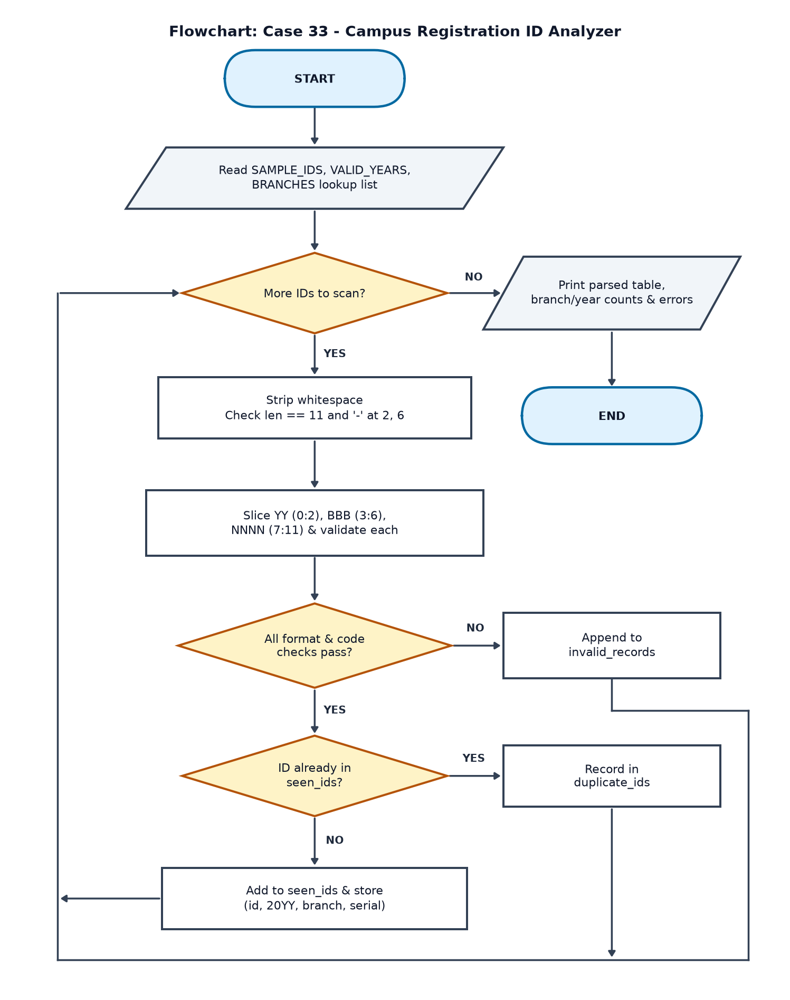
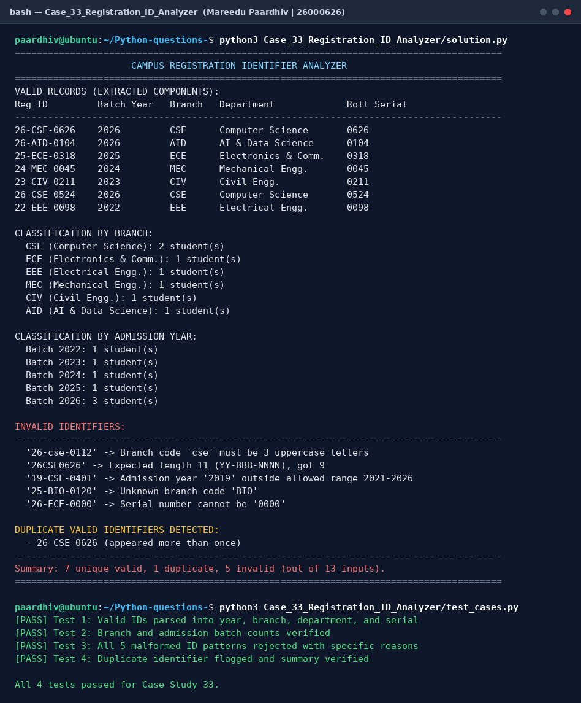

# Case Study 33 — Campus Registration Identifier Analyzer

**Student:** Mareedu Paardhiv | **Roll No:** 26000626

**Syllabus Topics:** Strings, slicing, character validation, loops, lists, classification

## 1. Problem Statement

Examine student identification strings, validate their structure, extract specified components, and classify records according to branch and admission year codes.

## 2. Objectives

- Validate structured campus IDs of the form `YY-BBB-NNNN` using string length, indexing, and character checks.
- Report specific formatting errors (wrong length, missing hyphens, lowercase branch, bad year, zero serial).
- Extract admission year, branch code, department name, and roll serial for every valid identifier.
- Classify unique valid students by branch and admission batch while flagging duplicate IDs.

## 3. Assumptions

- Format is fixed at 11 characters after stripping outer whitespace: `YY-BBB-NNNN`.
- Valid admission year prefixes are `'21'` through `'26'` (representing batches 2021-2026).
- Valid uppercase branch codes are `CSE`, `ECE`, `EEE`, `MEC`, `CIV`, and `AID`.
- The 4-digit serial number must be numeric and cannot be `'0000'`.

## 4. Algorithm

```text
1. START
2. Define valid_years tuple, branches lookup tuples, and sample_ids list.
3. For each raw string in sample_ids, strip outer whitespace.
4. Check len(reg_id) == 11 and '-' at indices 2 and 6.
5. Slice year_part = reg_id[0:2], branch_part = reg_id[3:6], serial_part = reg_id[7:11].
6. Validate digits in year_part (21..26), uppercase letters in branch_part (matching branches), and digits != '0000' in serial_part.
7. If errors exist, append to invalid_records; else if already in seen_ids, append to duplicate_ids; else add extracted tuple to valid_records.
8. Loop through valid_records to count totals per branch and per batch year.
9. Print valid extracted table, classification counts, invalid IDs, and duplicates.
10. END
```

## 5. Flowchart



## 6. Pseudocode

```text
BEGIN REGISTRATION_ID_ANALYZER
    SET valid_years <- ("21","22","23","24","25","26")
    SET branches <- [("CSE","Computer Science"), ...]

    FOR EACH item IN sample_ids DO
        reg_id <- STRIP(item)
        errors <- []
        IF LENGTH(reg_id) != 11 THEN APPEND "Wrong length" TO errors
        ELSE
            IF reg_id[2] != '-' OR reg_id[6] != '-' THEN APPEND "Missing hyphen" TO errors
            SLICE yy <- reg_id[0:2], bbb <- reg_id[3:6], nnnn <- reg_id[7:11]
            IF yy NOT IN valid_years THEN APPEND "Invalid year" TO errors
            IF bbb NOT UPPERCASE ALPHA OR NOT IN branches THEN APPEND "Invalid branch" TO errors
            IF NOT ISDIGIT(nnnn) OR nnnn = "0000" THEN APPEND "Invalid serial" TO errors
        END IF

        IF errors IS EMPTY THEN
            IF reg_id IN seen_ids THEN APPEND reg_id TO duplicate_ids
            ELSE APPEND extracted tuple TO valid_records; ADD reg_id TO seen_ids
        ELSE
            APPEND (reg_id, errors) TO invalid_records
        END IF
    END FOR
    PRINT parsed records, branch/year counts, invalid entries, and duplicates
END
```

## 7. Python Source Code

```python
"""
Case Study 33: Campus Registration Identifier Analyzer
Name: Mareedu Paardhiv | Roll No: 26000626
"""

valid_years = ("21", "22", "23", "24", "25", "26")
branches = [
    ("CSE", "Computer Science"),
    ("ECE", "Electronics & Comm."),
    ("EEE", "Electrical Engg."),
    ("MEC", "Mechanical Engg."),
    ("CIV", "Civil Engg."),
    ("AID", "AI & Data Science"),
]

sample_ids = [
    "26-CSE-0626",
    "26-AID-0104",
    "25-ECE-0318",
    "24-MEC-0045",
    "23-CIV-0211",
    "26-CSE-0524",
    "22-EEE-0098",
    "26-cse-0112",     # lowercase branch code -> invalid
    "26CSE0626",       # missing hyphens -> invalid
    "19-CSE-0401",     # admission year out of range -> invalid
    "25-BIO-0120",     # unknown branch code -> invalid
    "26-ECE-0000",     # serial 0000 -> invalid
    "26-CSE-0626",     # duplicate valid ID
]

valid_records = []
invalid_records = []
seen_ids = []
duplicate_ids = []

for item in sample_ids:
    reg_id = item.strip()
    errors = []

    # Expected format: YY-BBB-NNNN (11 characters)
    if len(reg_id) != 11:
        errors.append(f"Expected length 11 (YY-BBB-NNNN), got {len(reg_id)}")
    else:
        if reg_id[2] != "-" or reg_id[6] != "-":
            errors.append("Missing or misplaced '-' separator at index 2 or 6")

        year_part = reg_id[0:2]
        branch_part = reg_id[3:6]
        serial_part = reg_id[7:11]

        # Validate admission year
        if not year_part.isdigit():
            errors.append(f"Year code '{year_part}' must be 2 digits")
        elif year_part not in valid_years:
            errors.append(f"Admission year '20{year_part}' outside allowed range 2021-2026")

        # Validate branch code
        branch_name = ""
        for b_code, b_name in branches:
            if b_code == branch_part:
                branch_name = b_name
                break

        if not (branch_part.isalpha() and branch_part.isupper()):
            errors.append(f"Branch code '{branch_part}' must be 3 uppercase letters")
        elif branch_name == "":
            errors.append(f"Unknown branch code '{branch_part}'")

        # Validate 4-digit roll serial
        if not serial_part.isdigit():
            errors.append(f"Serial '{serial_part}' must be 4 digits")
        elif serial_part == "0000":
            errors.append("Serial number cannot be '0000'")

    if len(errors) > 0:
        invalid_records.append((reg_id, errors))
    else:
        if reg_id in seen_ids:
            duplicate_ids.append(reg_id)
        else:
            seen_ids.append(reg_id)
            full_year = "20" + reg_id[0:2]
            b_code = reg_id[3:6]
            serial_no = reg_id[7:11]
            dept_name = ""
            for code_item, name_item in branches:
                if code_item == b_code:
                    dept_name = name_item
                    break
            valid_records.append((reg_id, full_year, b_code, dept_name, serial_no))

print("=" * 88)
print("                     CAMPUS REGISTRATION IDENTIFIER ANALYZER")
print("=" * 88)
print("VALID RECORDS (EXTRACTED COMPONENTS):")
print(f"{'Reg ID':<14} {'Batch Year':<12} {'Branch':<8} {'Department':<22} {'Roll Serial'}")
print("-" * 88)

for reg_id, year, b_code, b_name, serial in valid_records:
    print(f"{reg_id:<14} {year:<12} {b_code:<8} {b_name:<22} {serial}")

print("\nCLASSIFICATION BY BRANCH:")
for b_code, b_name in branches:
    cnt = 0
    for _, _, rec_b, _, _ in valid_records:
        if rec_b == b_code:
            cnt = cnt + 1
    if cnt > 0:
        print(f"  {b_code} ({b_name}): {cnt} student(s)")

print("\nCLASSIFICATION BY ADMISSION YEAR:")
for y_code in valid_years:
    full_y = "20" + y_code
    cnt = 0
    for _, rec_y, _, _, _ in valid_records:
        if rec_y == full_y:
            cnt = cnt + 1
    if cnt > 0:
        print(f"  Batch {full_y}: {cnt} student(s)")

print("\nINVALID IDENTIFIERS:")
print("-" * 88)
for bad_id, errs in invalid_records:
    print(f"  '{bad_id}' -> {'; '.join(errs)}")

if len(duplicate_ids) > 0:
    print("\nDUPLICATE VALID IDENTIFIERS DETECTED:")
    for dup in duplicate_ids:
        print(f"  - {dup} (appeared more than once)")

print("-" * 88)
print(f"Summary: {len(valid_records)} unique valid, {len(duplicate_ids)} duplicate, "
      f"{len(invalid_records)} invalid (out of {len(sample_ids)} inputs).")
print("=" * 88)
```

## 8. Test Cases

| Test ID | Scenario | Expected Result | Status |
| :--- | :--- | :--- | :--- |
| TC-01 | Valid ID parsing ('26-CSE-0626', '25-ECE-0318') | Extracts year, branch code, department, and serial | PASS |
| TC-02 | Branch & batch classification counts | Reports CSE: 2 students and Batch 2026: 3 students | PASS |
| TC-03 | Malformed patterns (case, hyphens, year, branch, 0000) | All 5 invalid IDs rejected with exact error messages | PASS |
| TC-04 | Duplicate ID & summary totals | Flags duplicate '26-CSE-0626'; 7 unique valid, 5 invalid | PASS |

Run automated tests: `python3 Case_33_Registration_ID_Analyzer/test_cases.py`

## 9. Output & Output Screenshot



<details>
<summary>View raw console output (output.txt)</summary>

```text
========================================================================================
                     CAMPUS REGISTRATION IDENTIFIER ANALYZER
========================================================================================
VALID RECORDS (EXTRACTED COMPONENTS):
Reg ID         Batch Year   Branch   Department             Roll Serial
----------------------------------------------------------------------------------------
26-CSE-0626    2026         CSE      Computer Science       0626
26-AID-0104    2026         AID      AI & Data Science      0104
25-ECE-0318    2025         ECE      Electronics & Comm.    0318
24-MEC-0045    2024         MEC      Mechanical Engg.       0045
23-CIV-0211    2023         CIV      Civil Engg.            0211
26-CSE-0524    2026         CSE      Computer Science       0524
22-EEE-0098    2022         EEE      Electrical Engg.       0098

CLASSIFICATION BY BRANCH:
  CSE (Computer Science): 2 student(s)
  ECE (Electronics & Comm.): 1 student(s)
  EEE (Electrical Engg.): 1 student(s)
  MEC (Mechanical Engg.): 1 student(s)
  CIV (Civil Engg.): 1 student(s)
  AID (AI & Data Science): 1 student(s)

CLASSIFICATION BY ADMISSION YEAR:
  Batch 2022: 1 student(s)
  Batch 2023: 1 student(s)
  Batch 2024: 1 student(s)
  Batch 2025: 1 student(s)
  Batch 2026: 3 student(s)

INVALID IDENTIFIERS:
----------------------------------------------------------------------------------------
  '26-cse-0112' -> Branch code 'cse' must be 3 uppercase letters
  '26CSE0626' -> Expected length 11 (YY-BBB-NNNN), got 9
  '19-CSE-0401' -> Admission year '2019' outside allowed range 2021-2026
  '25-BIO-0120' -> Unknown branch code 'BIO'
  '26-ECE-0000' -> Serial number cannot be '0000'

DUPLICATE VALID IDENTIFIERS DETECTED:
  - 26-CSE-0626 (appeared more than once)
----------------------------------------------------------------------------------------
Summary: 7 unique valid, 1 duplicate, 5 invalid (out of 13 inputs).
========================================================================================
```

</details>

## 10. Conclusion

String slicing, built-in character checks (`.isdigit()`, `.isalpha()`, `.isupper()`), and simple loops validate and parse registration strings cleanly without needing regular expressions or functions.
