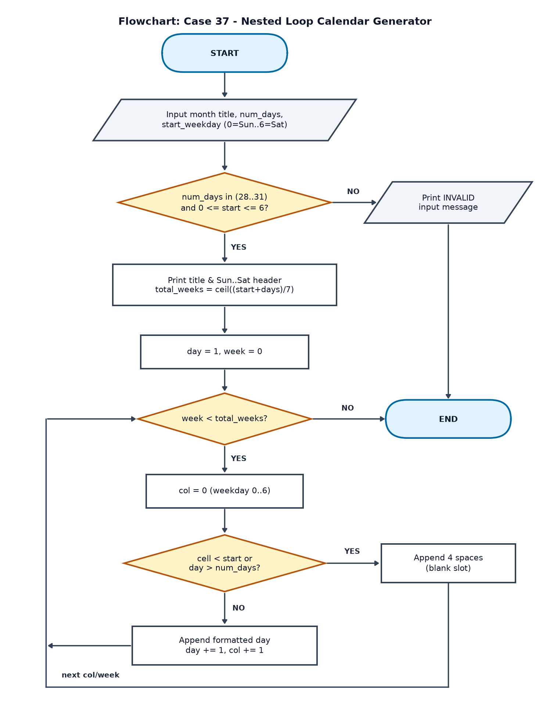
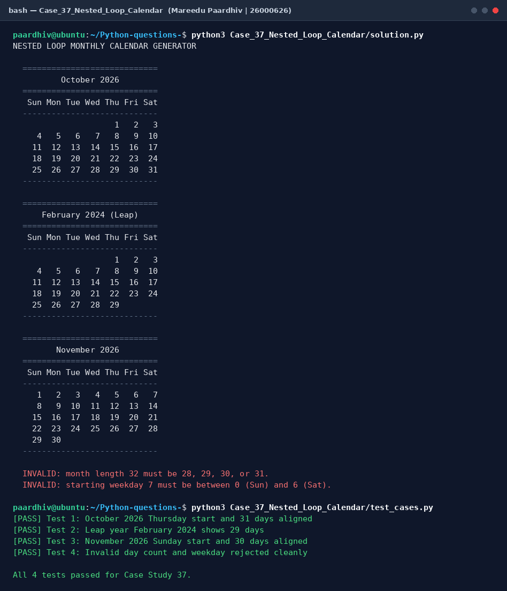

# Case Study 37 — Nested Loop Calendar Generator

**Student:** Mareedu Paardhiv | **Roll No:** 26000626

**Syllabus Topics:** Nested loops, pattern/grid generation, alignment, input validation, leap years

## 1. Problem Statement

Generate a formatted monthly calendar using the supplied starting weekday and number of days, correctly aligning weeks and handling valid month lengths.

## 2. Objectives

- Validate supplied month lengths (28, 29, 30, 31) and starting weekday indices (`0=Sun` to `6=Sat`).
- Determine exact February days accurately using leap-year divisibility rules.
- Use nested loops (outer week loop, inner 7-column weekday loop) to align leading blanks and day numbers.
- Produce clear diagnostic errors for invalid day counts or weekday indices.

## 3. Assumptions

- Weekday indexing starts at 0 for Sunday and ends at 6 for Saturday.
- A year is a leap year when divisible by 4 and not 100, or divisible by 400.
- Each date cell occupies a fixed 4-character right-aligned column so columns align cleanly.

## 4. Algorithm

```text
1. START
2. Define weekdays tuple, valid_lengths = (28, 29, 30, 31), and calendar_requests list.
3. For each request, determine num_days from month/year (applying leap-year rules for February) or override value.
4. Validate num_days in (28, 29, 30, 31) and 0 <= start_weekday <= 6; if invalid, print error and continue.
5. Print title banner and weekday header (Sun  Mon  Tue  Wed  Thu  Fri  Sat).
6. Compute total_weeks = (start_weekday + num_days + 6) // 7 and set day = 1.
7. Outer loop: for week from 0 to total_weeks - 1:
8.   Initialize row_str = ''.
9.   Inner loop: for col from 0 to 6:
10.     Compute cell_index = week * 7 + col.
11.     If cell_index < start_weekday or day > num_days, append 4 spaces; else append formatted day and increment day.
12.   Print row_str.
13. END
```

## 5. Flowchart



## 6. Pseudocode

```text
BEGIN NESTED_LOOP_CALENDAR
    FOR EACH (title, month, year, start_weekday, override_days) IN calendar_requests DO
        DETERMINE num_days using month & leap-year rule (or override_days)

        IF num_days NOT IN (28, 29, 30, 31) OR start_weekday < 0 OR start_weekday > 6 THEN
            PRINT "INVALID" message; CONTINUE
        END IF

        PRINT title AND "Sun Mon Tue Wed Thu Fri Sat"
        total_weeks <- (start_weekday + num_days + 6) // 7
        day <- 1

        FOR week <- 0 TO total_weeks - 1 DO
            row <- ""
            FOR col <- 0 TO 6 DO
                cell <- (week * 7) + col
                IF cell < start_weekday OR day > num_days THEN
                    row <- row + "    "
                ELSE
                    row <- row + FORMAT_RIGHT_4(day)
                    day <- day + 1
                END IF
            END FOR
            PRINT row
        END FOR
    END FOR
END
```

## 7. Python Source Code

```python
"""
Case Study 37: Nested Loop Calendar Generator
Name: Mareedu Paardhiv | Roll No: 26000626
"""

weekdays = ("Sun", "Mon", "Tue", "Wed", "Thu", "Fri", "Sat")
valid_lengths = (28, 29, 30, 31)

# Calendar requests: (title, month_number, year, start_weekday_0_to_6, override_days_or_0)
# When override_days > 0, it directly tests month-length validation
calendar_requests = [
    ("October 2026", 10, 2026, 4, 0),          # 31 days, starts Thu (4)
    ("February 2024 (Leap)", 2, 2024, 4, 0),   # leap year -> 29 days, starts Thu (4)
    ("November 2026", 11, 2026, 0, 0),         # 30 days, starts Sun (0)
    ("Invalid Days Check", 1, 2026, 2, 32),    # invalid day count 32
    ("Invalid Weekday Check", 4, 2026, 7, 0),  # invalid weekday 7
]

print("NESTED LOOP MONTHLY CALENDAR GENERATOR\n")

for req in calendar_requests:
    title, month, year, start_weekday, override_days = req

    # Determine days in month (using leap year rule for February)
    if override_days > 0:
        num_days = override_days
    elif month < 1 or month > 12:
        num_days = -1
    elif month in (1, 3, 5, 7, 8, 10, 12):
        num_days = 31
    elif month in (4, 6, 9, 11):
        num_days = 30
    else:
        if (year % 4 == 0 and year % 100 != 0) or (year % 400 == 0):
            num_days = 29
        else:
            num_days = 28

    # Validate month length and starting weekday
    if num_days not in valid_lengths:
        print(f"  INVALID: month length {num_days} must be 28, 29, 30, or 31.")
        continue

    if start_weekday < 0 or start_weekday > 6:
        print(f"  INVALID: starting weekday {start_weekday} must be between 0 (Sun) and 6 (Sat).")
        continue

    # Print formatted calendar header
    width = 28
    print("  " + ("=" * width))
    print("  " + title.center(width))
    print("  " + ("=" * width))

    header = ""
    for w in range(7):
        header = header + f"{weekdays[w]:>4}"
    print("  " + header)
    print("  " + ("-" * width))

    # Print weeks and days using nested loops
    total_cells = start_weekday + num_days
    total_weeks = (total_cells + 6) // 7

    day = 1
    for week in range(total_weeks):
        row_str = ""
        for col in range(7):
            cell_index = (week * 7) + col
            if cell_index < start_weekday or day > num_days:
                row_str = row_str + "    "
            else:
                row_str = row_str + f"{day:>4}"
                day = day + 1
        print("  " + row_str)

    print("  " + ("-" * width))
    print()
```

## 8. Test Cases

| Test ID | Scenario | Expected Result | Status |
| :--- | :--- | :--- | :--- |
| TC-01 | October 2026 Thursday start alignment | Inserts 16 leading spaces before Day 1 and ends at 31 | PASS |
| TC-02 | Leap year February 2024 | Applies leap year rule and displays 29 days | PASS |
| TC-03 | November 2026 Sunday start | Starts on column 0 (Sun) and formats all 30 days | PASS |
| TC-04 | Invalid month length (32) & weekday (7) | Both rejected cleanly with validation error messages | PASS |

Run automated tests: `python3 Case_37_Nested_Loop_Calendar/test_cases.py`

## 9. Output & Output Screenshot



<details>
<summary>View raw console output (output.txt)</summary>

```text
NESTED LOOP MONTHLY CALENDAR GENERATOR

  ============================
          October 2026        
  ============================
   Sun Mon Tue Wed Thu Fri Sat
  ----------------------------
                     1   2   3
     4   5   6   7   8   9  10
    11  12  13  14  15  16  17
    18  19  20  21  22  23  24
    25  26  27  28  29  30  31
  ----------------------------

  ============================
      February 2024 (Leap)    
  ============================
   Sun Mon Tue Wed Thu Fri Sat
  ----------------------------
                     1   2   3
     4   5   6   7   8   9  10
    11  12  13  14  15  16  17
    18  19  20  21  22  23  24
    25  26  27  28  29        
  ----------------------------

  ============================
         November 2026        
  ============================
   Sun Mon Tue Wed Thu Fri Sat
  ----------------------------
     1   2   3   4   5   6   7
     8   9  10  11  12  13  14
    15  16  17  18  19  20  21
    22  23  24  25  26  27  28
    29  30                    
  ----------------------------

  INVALID: month length 32 must be 28, 29, 30, or 31.
  INVALID: starting weekday 7 must be between 0 (Sun) and 6 (Sat).
```

</details>

## 10. Conclusion

Nested `for` loops naturally model week-by-weekday calendar formatting. Fixed-width cell padding and input validation ensure proper grid alignment across 28-, 29-, 30-, and 31-day months.
