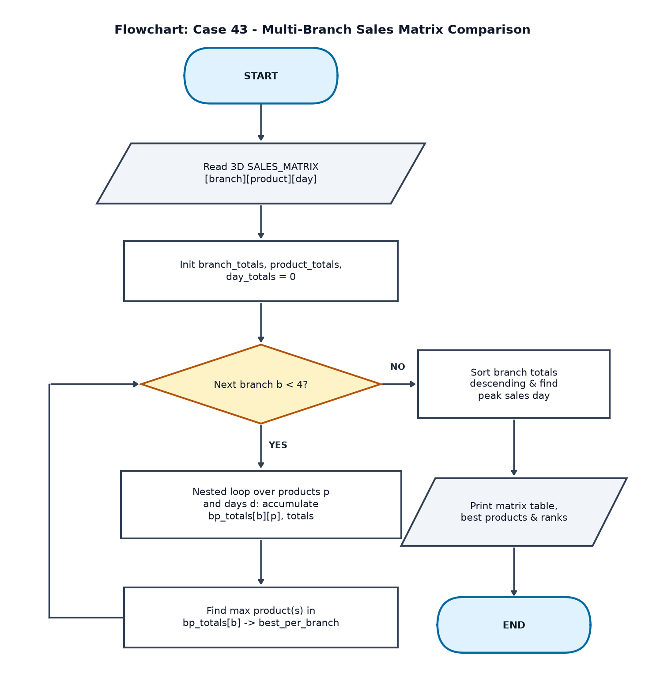
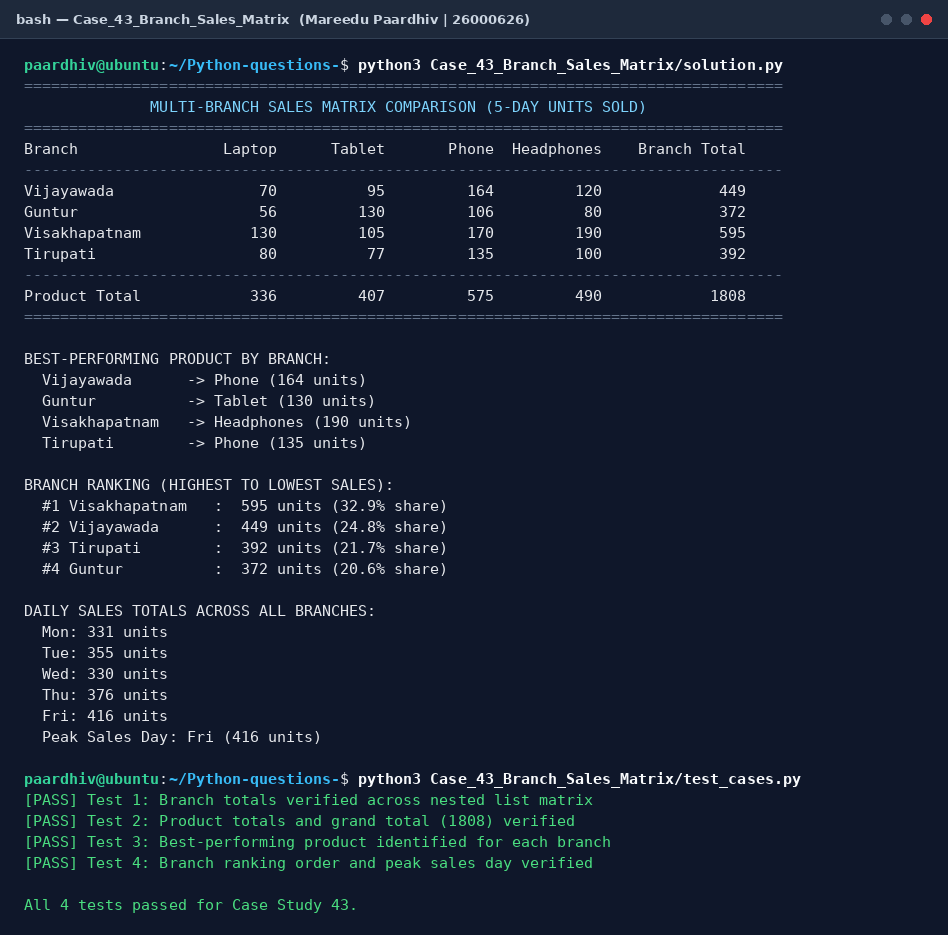

# Case Study 43 — Multi-Branch Sales Matrix Comparison

**Student:** Mareedu Paardhiv | **Roll No:** 26000626

**Syllabus Topics:** Nested lists (3D matrix), nested loops, row/column aggregation, sorting

## 1. Problem Statement

Store product sales across branches and days in nested lists, calculate product totals, compare branches, and identify the best-performing product for each branch.

## 2. Objectives

- Model multi-branch, multi-product, 5-day sales counts using a 3D nested list structure.
- Aggregate branch-product subtotals, overall product totals, branch totals, and daily totals via nested loops.
- Identify the top-selling product within each branch (including tie handling).
- Rank branches from highest to lowest total sales and determine the peak sales day.

## 3. Assumptions

- Four branches (Vijayawada, Guntur, Visakhapatnam, Tirupati) track four products across five weekdays (Mon-Fri).
- All matrix entries represent integer units sold; every branch has identical product and day dimensions.
- Branch ranking uses a simple selection sort on `(total, branch_name)` tuples.

## 4. Algorithm

```text
1. START
2. Read 3D nested list sales_matrix[branch][product][day].
3. Initialize bp_totals, branch_totals, product_totals, day_totals, and grand_total to zeros.
4. Run triple nested loops over branch b, product p, and day d to sum units across all dimensions.
5. For each branch b, scan bp_totals[b] to find the maximum units and best product name(s).
6. Build (branch_total, branch_name) tuples and sort descending using selection sort.
7. Scan day_totals to locate the peak weekday across all branches.
8. Print formatted Branch x Product matrix table, best product per branch, branch ranking, and daily totals.
9. END
```

## 5. Flowchart



## 6. Pseudocode

```text
BEGIN BRANCH_SALES_MATRIX
    FOR b <- 0 TO num_branches - 1 DO
        b_sum <- 0
        FOR p <- 0 TO num_products - 1 DO
            p_sum <- 0
            FOR d <- 0 TO num_days - 1 DO
                val <- sales_matrix[b][p][d]
                p_sum <- p_sum + val
                day_totals[d] <- day_totals[d] + val
            END FOR
            bp_totals[b][p] <- p_sum
            product_totals[p] <- product_totals[p] + p_sum
            b_sum <- b_sum + p_sum
        END FOR
        branch_totals[b] <- b_sum
    END FOR

    FOR EACH branch b DO FIND max product in bp_totals[b]
    SELECTION_SORT (branch_totals, branches) descending
    PRINT summary matrix, best products, ranking, and peak day
END
```

## 7. Python Source Code

```python
"""
Case Study 43: Multi-Branch Sales Matrix Comparison
Name: Mareedu Paardhiv | Roll No: 26000626
"""

branches = ["Vijayawada", "Guntur", "Visakhapatnam", "Tirupati"]
products = ["Laptop", "Tablet", "Phone", "Headphones"]
days = ["Mon", "Tue", "Wed", "Thu", "Fri"]

# 3D nested list: sales_matrix[branch_index][product_index][day_index]
sales_matrix = [
    # Vijayawada
    [
        [12, 15, 11, 14, 18],   # Laptop = 70
        [18, 20, 16, 19, 22],   # Tablet = 95
        [30, 28, 35, 31, 40],   # Phone = 164 (best)
        [22, 24, 20, 25, 29],   # Headphones = 120
    ],
    # Guntur
    [
        [10, 12, 9, 11, 14],    # Laptop = 56
        [24, 26, 22, 28, 30],   # Tablet = 130 (best)
        [20, 19, 21, 22, 24],   # Phone = 106
        [15, 16, 14, 18, 17],   # Headphones = 80
    ],
    # Visakhapatnam
    [
        [22, 25, 24, 28, 31],   # Laptop = 130
        [19, 21, 20, 22, 23],   # Tablet = 105
        [32, 34, 30, 36, 38],   # Phone = 170
        [35, 38, 34, 40, 43],   # Headphones = 190 (best)
    ],
    # Tirupati
    [
        [14, 16, 15, 17, 18],   # Laptop = 80
        [15, 14, 16, 15, 17],   # Tablet = 77
        [25, 27, 24, 29, 30],   # Phone = 135 (best)
        [18, 20, 19, 21, 22],   # Headphones = 100
    ],
]

num_branches = len(branches)
num_products = len(products)
num_days = len(days)

bp_totals = []
branch_totals = []
product_totals = [0] * num_products
day_totals = [0] * num_days
grand_total = 0

# Traverse 3D nested list using nested loops
for b in range(num_branches):
    row_totals = []
    b_sum = 0
    for p in range(num_products):
        p_sum = 0
        for d in range(num_days):
            val = sales_matrix[b][p][d]
            p_sum = p_sum + val
            day_totals[d] = day_totals[d] + val
        row_totals.append(p_sum)
        product_totals[p] = product_totals[p] + p_sum
        b_sum = b_sum + p_sum
    bp_totals.append(row_totals)
    branch_totals.append(b_sum)
    grand_total = grand_total + b_sum

# Find best-performing product for each branch
best_per_branch = []
for b in range(num_branches):
    max_units = bp_totals[b][0]
    best_names = [products[0]]
    for p in range(1, num_products):
        val = bp_totals[b][p]
        if val > max_units:
            max_units = val
            best_names = [products[p]]
        elif val == max_units:
            best_names.append(products[p])
    best_per_branch.append((branches[b], ", ".join(best_names), max_units))

# Rank branches descending using simple selection sort
ranked_branches = []
for b in range(num_branches):
    ranked_branches.append((branch_totals[b], branches[b]))

for i in range(len(ranked_branches)):
    best_idx = i
    for j in range(i + 1, len(ranked_branches)):
        if ranked_branches[j][0] > ranked_branches[best_idx][0]:
            best_idx = j
    temp = ranked_branches[i]
    ranked_branches[i] = ranked_branches[best_idx]
    ranked_branches[best_idx] = temp

print("=" * 84)
print("              MULTI-BRANCH SALES MATRIX COMPARISON (5-DAY UNITS SOLD)")
print("=" * 84)
header = f"{'Branch':<16}"
for prod in products:
    header = header + f"{prod:>12}"
header = header + f"{'Branch Total':>16}"
print(header)
print("-" * 84)

for b in range(num_branches):
    line = f"{branches[b]:<16}"
    for p in range(num_products):
        line = line + f"{bp_totals[b][p]:>12}"
    line = line + f"{branch_totals[b]:>16}"
    print(line)

print("-" * 84)
prod_line = f"{'Product Total':<16}"
for pt in product_totals:
    prod_line = prod_line + f"{pt:>12}"
prod_line = prod_line + f"{grand_total:>16}"
print(prod_line)
print("=" * 84)

print("\nBEST-PERFORMING PRODUCT BY BRANCH:")
for branch_name, prod_name, units in best_per_branch:
    print(f"  {branch_name:<15} -> {prod_name} ({units} units)")

print("\nBRANCH RANKING (HIGHEST TO LOWEST SALES):")
for rank in range(len(ranked_branches)):
    tot, b_name = ranked_branches[rank]
    share = (tot / grand_total) * 100.0
    print(f"  #{rank + 1} {b_name:<15} : {tot:>4} units ({share:.1f}% share)")

print("\nDAILY SALES TOTALS ACROSS ALL BRANCHES:")
peak_day_idx = 0
for d in range(num_days):
    if day_totals[d] > day_totals[peak_day_idx]:
        peak_day_idx = d
    print(f"  {days[d]}: {day_totals[d]} units")
print(f"  Peak Sales Day: {days[peak_day_idx]} ({day_totals[peak_day_idx]} units)")
```

## 8. Test Cases

| Test ID | Scenario | Expected Result | Status |
| :--- | :--- | :--- | :--- |
| TC-01 | Branch totals across 3D matrix | Matches 449, 372, 595, and 392 units | PASS |
| TC-02 | Product totals & grand total | Matches 336, 407, 575, 490 and grand total 1,808 | PASS |
| TC-03 | Best product per branch | VJA: Phone, GNT: Tablet, VSP: Headphones, TPT: Phone | PASS |
| TC-04 | Branch ranking & peak sales day | Visakhapatnam #1; Peak day Fri with 416 units | PASS |

Run automated tests: `python3 Case_43_Branch_Sales_Matrix/test_cases.py`

## 9. Output & Output Screenshot



<details>
<summary>View raw console output (output.txt)</summary>

```text
====================================================================================
              MULTI-BRANCH SALES MATRIX COMPARISON (5-DAY UNITS SOLD)
====================================================================================
Branch                Laptop      Tablet       Phone  Headphones    Branch Total
------------------------------------------------------------------------------------
Vijayawada                70          95         164         120             449
Guntur                    56         130         106          80             372
Visakhapatnam            130         105         170         190             595
Tirupati                  80          77         135         100             392
------------------------------------------------------------------------------------
Product Total            336         407         575         490            1808
====================================================================================

BEST-PERFORMING PRODUCT BY BRANCH:
  Vijayawada      -> Phone (164 units)
  Guntur          -> Tablet (130 units)
  Visakhapatnam   -> Headphones (190 units)
  Tirupati        -> Phone (135 units)

BRANCH RANKING (HIGHEST TO LOWEST SALES):
  #1 Visakhapatnam   :  595 units (32.9% share)
  #2 Vijayawada      :  449 units (24.8% share)
  #3 Tirupati        :  392 units (21.7% share)
  #4 Guntur          :  372 units (20.6% share)

DAILY SALES TOTALS ACROSS ALL BRANCHES:
  Mon: 331 units
  Tue: 355 units
  Wed: 330 units
  Thu: 376 units
  Fri: 416 units
  Peak Sales Day: Fri (416 units)
```

</details>

## 10. Conclusion

Traversing nested lists across three dimensions lets us compute branch totals, product totals, daily trends, and per-branch leaders cleanly using only nested loops and basic list indexing.
