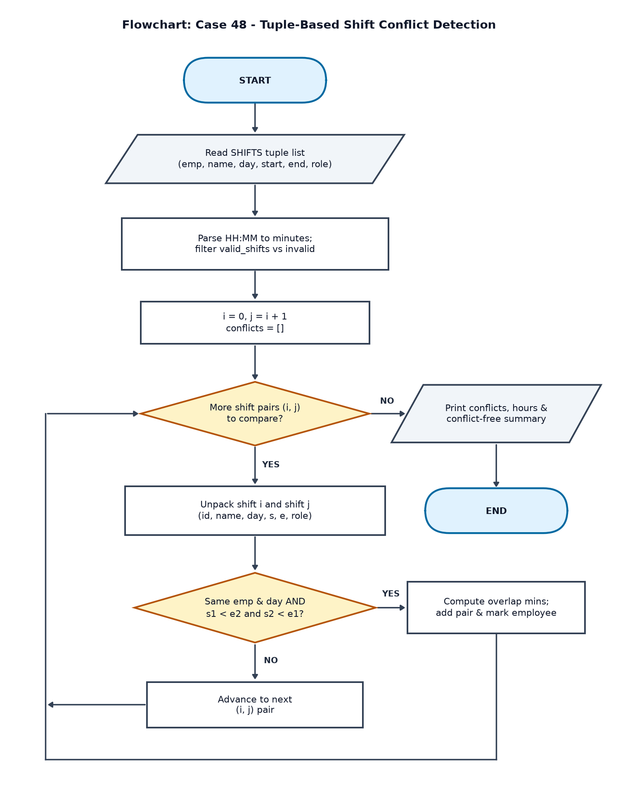
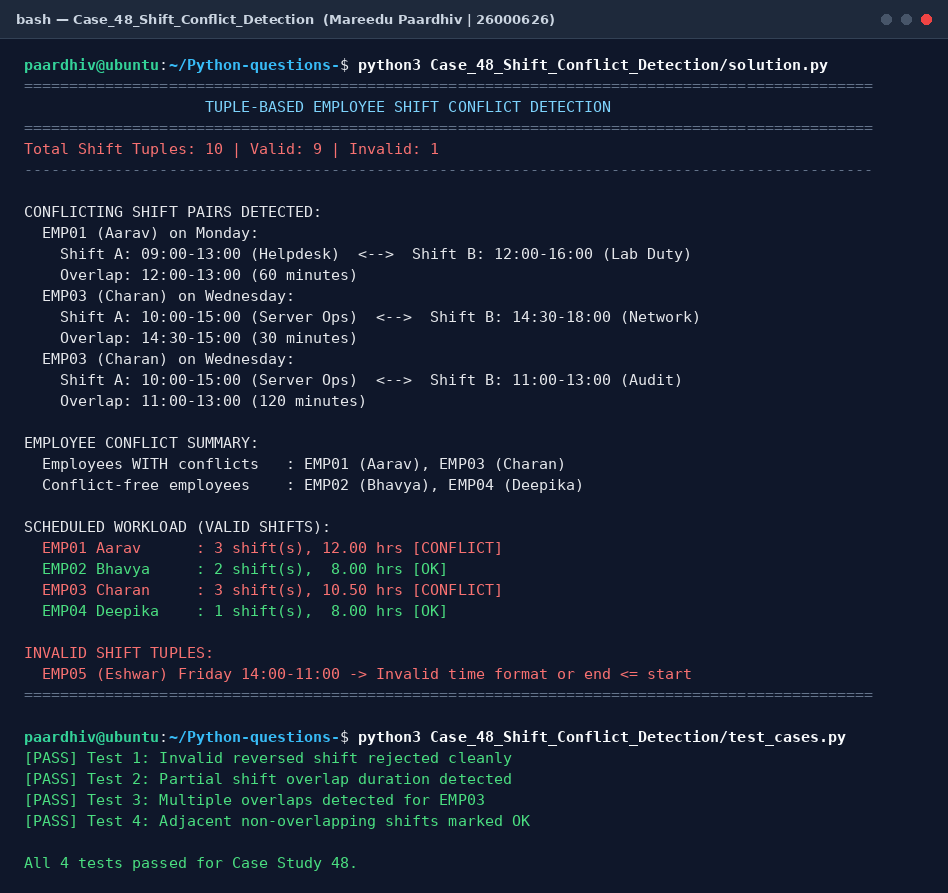

# Case Study 48 — Tuple-Based Employee Shift Conflict Detection

**Student:** Mareedu Paardhiv | **Roll No:** 26000626

**Syllabus Topics:** Tuples, tuple unpacking, string time parsing, interval overlap logic, nested loops

## 1. Problem Statement

Represent employee shifts as tuples, compare time intervals, detect overlapping assignments, and identify employees with conflicting schedules.

## 2. Objectives

- Store shift schedules immutably as tuples containing employee ID, name, day, start time, end time, and role.
- Parse `'HH:MM'` time strings into integer minutes while rejecting malformed or reversed intervals (`end <= start`).
- Compare shift pairs for the same employee and day using tuple unpacking and interval overlap checks.
- Compute overlap durations, separate conflicted vs conflict-free staff, and summarize total hours.

## 3. Assumptions

- Each shift occurs within a single calendar day in 24-hour `'HH:MM'` format (`00:00` to `23:59`).
- Back-to-back shifts such as `08:00-12:00` and `12:00-16:00` are adjacent and do NOT conflict.
- Overlap exists if and only if `s1 < e2` and `s2 < e1`.

## 4. Algorithm

```text
1. START
2. Read shifts tuple list.
3. Loop over shifts, unpack each tuple, split 'HH:MM' strings into integer minutes, and separate valid shifts from invalid ones (end <= start).
4. Collect unique valid (emp_id, name) pairs into all_employees.
5. Run pairwise nested loops (i from 0 to n-1, j from i+1 to n-1) over valid_shifts.
6. Unpack shift i and shift j; if same employee ID and same day, check if s1 < e2 and s2 < e1.
7. If overlapping, calculate overlap start, overlap end, and overlap minutes; record conflict tuple and mark employee.
8. Collect remaining employees as conflict-free and sum valid shift durations per employee.
9. Print conflicting pairs, employee conflict summary, workload hours, and invalid tuples.
10. END
```

## 5. Flowchart



## 6. Pseudocode

```text
BEGIN SHIFT_CONFLICT_DETECTION
    FOR EACH shift IN shifts DO
        UNPACK (emp_id, name, day, s_str, e_str, role) <- shift
        PARSE s_str, e_str into minutes s_min, e_min
        IF invalid format OR e_min <= s_min THEN
            APPEND shift TO invalid_shifts
        ELSE
            APPEND (emp_id, name, day, s_str, e_str, role, s_min, e_min) TO valid_shifts
        END IF
    END FOR

    FOR i <- 0 TO LENGTH(valid_shifts) - 1 DO
        FOR j <- i + 1 TO LENGTH(valid_shifts) - 1 DO
            IF id[i] = id[j] AND day[i] = day[j] AND s[i] < e[j] AND s[j] < e[i] THEN
                ov <- MIN(e[i], e[j]) - MAX(s[i], s[j])
                RECORD conflict pair and mark employee
            END IF
        END FOR
    END FOR
    PRINT conflicts, conflict-free staff, workload hours, and invalid shifts
END
```

## 7. Python Source Code

```python
"""
Case Study 48: Tuple-Based Employee Shift Conflict Detection
Name: Mareedu Paardhiv | Roll No: 26000626
"""

# Shift tuples: (emp_id, emp_name, day, start_time, end_time, role)
shifts = [
    ("EMP01", "Aarav", "Monday", "09:00", "13:00", "Helpdesk"),
    ("EMP01", "Aarav", "Monday", "12:00", "16:00", "Lab Duty"),       # overlaps 12:00-13:00
    ("EMP01", "Aarav", "Tuesday", "09:00", "13:00", "Helpdesk"),
    ("EMP02", "Bhavya", "Monday", "08:00", "12:00", "Reception"),
    ("EMP02", "Bhavya", "Monday", "12:00", "16:00", "Reception"),     # adjacent, no overlap
    ("EMP03", "Charan", "Wednesday", "10:00", "15:00", "Server Ops"),
    ("EMP03", "Charan", "Wednesday", "14:30", "18:00", "Network"),    # overlaps 14:30-15:00
    ("EMP03", "Charan", "Wednesday", "11:00", "13:00", "Audit"),      # overlaps 11:00-13:00
    ("EMP04", "Deepika", "Thursday", "09:30", "17:30", "Support"),
    ("EMP05", "Eshwar", "Friday", "14:00", "11:00", "Security"),      # invalid: end <= start
]

valid_shifts = []
invalid_shifts = []

# Step 1: Parse time strings and validate each shift tuple
for shift in shifts:
    emp_id, name, day, s_str, e_str, role = shift

    s_parts = s_str.strip().split(":")
    e_parts = e_str.strip().split(":")

    s_min = -1
    e_min = -1

    if len(s_parts) == 2 and s_parts[0].isdigit() and s_parts[1].isdigit():
        sh = int(s_parts[0])
        sm = int(s_parts[1])
        if 0 <= sh <= 23 and 0 <= sm <= 59:
            s_min = (sh * 60) + sm

    if len(e_parts) == 2 and e_parts[0].isdigit() and e_parts[1].isdigit():
        eh = int(e_parts[0])
        em = int(e_parts[1])
        if 0 <= eh <= 23 and 0 <= em <= 59:
            e_min = (eh * 60) + em

    if s_min == -1 or e_min == -1 or e_min <= s_min:
        invalid_shifts.append((shift, "Invalid time format or end <= start"))
    else:
        valid_shifts.append((emp_id, name, day, s_str, e_str, role, s_min, e_min))

# Collect unique valid employees
all_employees = []
for sh in valid_shifts:
    emp_pair = (sh[0], sh[1])
    if emp_pair not in all_employees:
        all_employees.append(emp_pair)

# Step 2: Compare every pair of valid shifts for overlap
conflicts = []
conflicted_employees = []

for i in range(len(valid_shifts)):
    id1, name1, day1, s1_str, e1_str, role1, s1, e1 = valid_shifts[i]
    for j in range(i + 1, len(valid_shifts)):
        id2, name2, day2, s2_str, e2_str, role2, s2, e2 = valid_shifts[j]

        if id1 == id2 and day1 == day2:
            if s1 < e2 and s2 < e1:
                if s1 > s2:
                    ov_start = s1
                else:
                    ov_start = s2

                if e1 < e2:
                    ov_end = e1
                else:
                    ov_end = e2

                ov_mins = ov_end - ov_start
                ov_range = f"{ov_start // 60:02d}:{ov_start % 60:02d}-{ov_end // 60:02d}:{ov_end % 60:02d}"

                conflicts.append((
                    id1, name1, day1,
                    f"{s1_str}-{e1_str} ({role1})",
                    f"{s2_str}-{e2_str} ({role2})",
                    ov_range, ov_mins
                ))
                if (id1, name1) not in conflicted_employees:
                    conflicted_employees.append((id1, name1))

conflict_free = []
for emp in all_employees:
    if emp not in conflicted_employees:
        conflict_free.append(emp)

# Display report
print("=" * 94)
print("                    TUPLE-BASED EMPLOYEE SHIFT CONFLICT DETECTION")
print("=" * 94)
print(f"Total Shift Tuples: {len(shifts)} | Valid: {len(valid_shifts)} | Invalid: {len(invalid_shifts)}")
print("-" * 94)

print("\nCONFLICTING SHIFT PAIRS DETECTED:")
if len(conflicts) == 0:
    print("  None.")
else:
    for emp_id, name, day, sh1, sh2, ov_range, ov_mins in conflicts:
        print(f"  {emp_id} ({name}) on {day}:")
        print(f"    Shift A: {sh1}  <-->  Shift B: {sh2}")
        print(f"    Overlap: {ov_range} ({ov_mins} minutes)")

bad_text_list = []
for eid, nm in conflicted_employees:
    bad_text_list.append(f"{eid} ({nm})")

good_text_list = []
for eid, nm in conflict_free:
    good_text_list.append(f"{eid} ({nm})")

print("\nEMPLOYEE CONFLICT SUMMARY:")
print("  Employees WITH conflicts   :", ", ".join(bad_text_list))
print("  Conflict-free employees    :", ", ".join(good_text_list))

print("\nSCHEDULED WORKLOAD (VALID SHIFTS):")
for eid, nm in all_employees:
    total_mins = 0
    shift_count = 0
    for sh in valid_shifts:
        if sh[0] == eid:
            total_mins = total_mins + (sh[7] - sh[6])
            shift_count = shift_count + 1
    hrs = round(total_mins / 60.0, 2)
    if (eid, nm) in conflicted_employees:
        flag = "[CONFLICT]"
    else:
        flag = "[OK]"
    print(f"  {eid} {nm:<10} : {shift_count} shift(s), {hrs:>5.2f} hrs {flag}")

if len(invalid_shifts) > 0:
    print("\nINVALID SHIFT TUPLES:")
    for sh, reason in invalid_shifts:
        print(f"  {sh[0]} ({sh[1]}) {sh[2]} {sh[3]}-{sh[4]} -> {reason}")
print("=" * 94)
```

## 8. Test Cases

| Test ID | Scenario | Expected Result | Status |
| :--- | :--- | :--- | :--- |
| TC-01 | Invalid reversed shift (EMP05 14:00-11:00) | Flagged and excluded; 9 valid, 1 invalid | PASS |
| TC-02 | Partial overlap for EMP01 | Detects 12:00-13:00 (60 minutes) overlap accurately | PASS |
| TC-03 | Multi-way overlaps for EMP03 (3 shifts) | Detects both overlapping pairs (30 min and 120 min) | PASS |
| TC-04 | Adjacent shifts for EMP02 (08-12 & 12-16) | Recognized as non-overlapping and marked [OK] | PASS |

Run automated tests: `python3 Case_48_Shift_Conflict_Detection/test_cases.py`

## 9. Output & Output Screenshot



<details>
<summary>View raw console output (output.txt)</summary>

```text
==============================================================================================
                    TUPLE-BASED EMPLOYEE SHIFT CONFLICT DETECTION
==============================================================================================
Total Shift Tuples: 10 | Valid: 9 | Invalid: 1
----------------------------------------------------------------------------------------------

CONFLICTING SHIFT PAIRS DETECTED:
  EMP01 (Aarav) on Monday:
    Shift A: 09:00-13:00 (Helpdesk)  <-->  Shift B: 12:00-16:00 (Lab Duty)
    Overlap: 12:00-13:00 (60 minutes)
  EMP03 (Charan) on Wednesday:
    Shift A: 10:00-15:00 (Server Ops)  <-->  Shift B: 14:30-18:00 (Network)
    Overlap: 14:30-15:00 (30 minutes)
  EMP03 (Charan) on Wednesday:
    Shift A: 10:00-15:00 (Server Ops)  <-->  Shift B: 11:00-13:00 (Audit)
    Overlap: 11:00-13:00 (120 minutes)

EMPLOYEE CONFLICT SUMMARY:
  Employees WITH conflicts   : EMP01 (Aarav), EMP03 (Charan)
  Conflict-free employees    : EMP02 (Bhavya), EMP04 (Deepika)

SCHEDULED WORKLOAD (VALID SHIFTS):
  EMP01 Aarav      : 3 shift(s), 12.00 hrs [CONFLICT]
  EMP02 Bhavya     : 2 shift(s),  8.00 hrs [OK]
  EMP03 Charan     : 3 shift(s), 10.50 hrs [CONFLICT]
  EMP04 Deepika    : 1 shift(s),  8.00 hrs [OK]

INVALID SHIFT TUPLES:
  EMP05 (Eshwar) Friday 14:00-11:00 -> Invalid time format or end <= start
==============================================================================================
```

</details>

## 10. Conclusion

Representing shift records as tuples makes unpacking clear and prevents accidental modification. Converting `'HH:MM'` strings to minutes keeps interval overlap comparisons simple and accurate.
