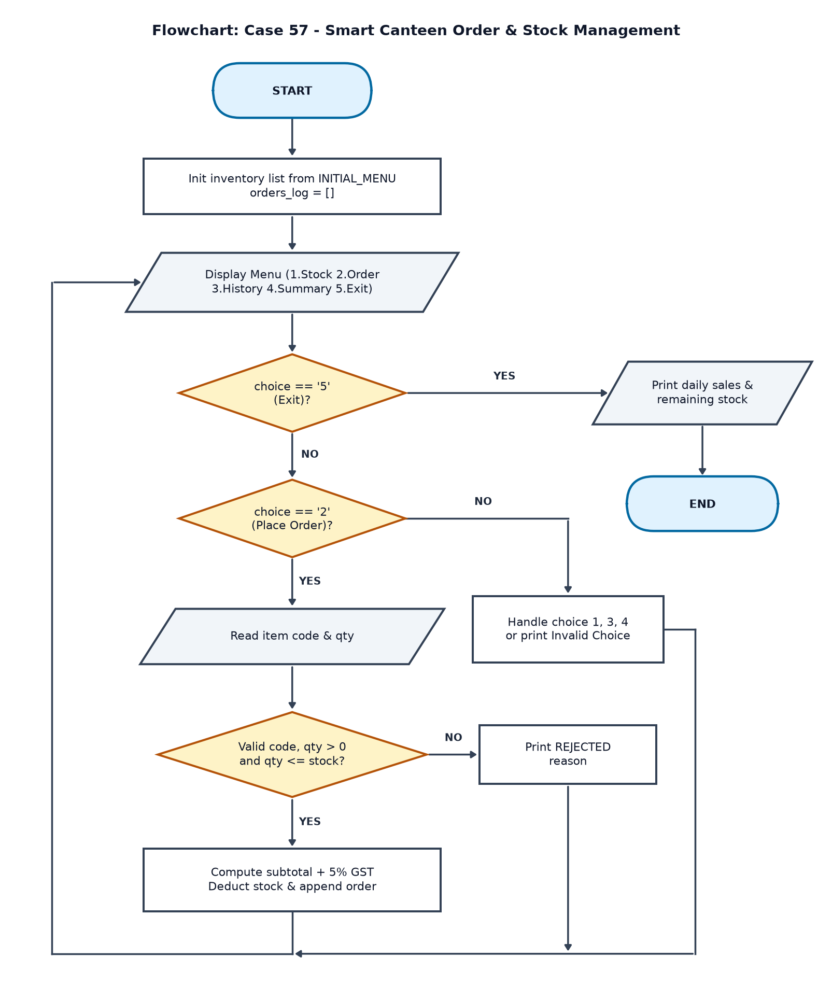
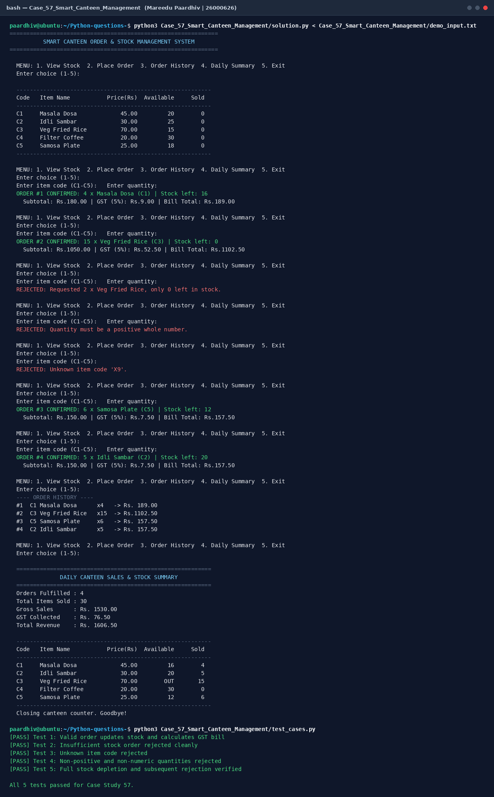

# Case Study 57 — Smart Canteen Order and Stock Management

**Student:** Mareedu Paardhiv | **Roll No:** 26000626

**Syllabus Topics:** Menu-driven while loop, mutable lists, tuple logs, billing, inventory control

## 1. Problem Statement

Process successive customer orders, calculate bills, update available inventory, reject unavailable quantities, and summarize daily sales and remaining stock.

## 2. Objectives

- Implement an interactive menu-driven loop for viewing stock, placing orders, checking history, and viewing summaries.
- Validate item codes and positive whole-number quantities without crashing on bad text input.
- Prevent overselling by rejecting orders whose quantity exceeds live available stock.
- Compute item subtotals plus 5% GST, store confirmed orders as tuples, and update remaining inventory.

## 3. Assumptions

- Menu items start with fixed opening stock: C1 Masala Dosa (20), C2 Idli Sambar (25), C3 Veg Fried Rice (15), C4 Filter Coffee (30), C5 Samosa Plate (18).
- Every valid order attracts a flat 5% GST on the item subtotal.
- Order quantities must be positive integers; invalid codes or quantities leave stock untouched.

## 4. Algorithm

```text
1. START
2. Initialize mutable `inventory` nested list from INITIAL_MENU and empty `orders_log` list.
3. Start a `while True` menu loop displaying options 1 (View Stock), 2 (Place Order), 3 (Order History), 4 (Daily Summary), 5 (Exit).
4. If choice is 1: display current stock and sold units per item.
5. If choice is 2: read item code; verify it exists in inventory. Read quantity; verify positive integer and qty <= available_stock.
6.   If valid: calculate subtotal, 5% GST, and total bill; deduct stock, increment sold count, and append order tuple to `orders_log`.
7.   If invalid: print explicit REJECTED reason without changing inventory.
8. If choice is 3: display all confirmed order tuples.
9. If choice is 4 or 5: compute aggregate orders, units sold, gross sales, GST, revenue, and remaining stock; exit loop on 5.
10. END
```

## 5. Flowchart



## 6. Pseudocode

```text
BEGIN SMART_CANTEEN_MANAGEMENT
    INIT inventory FROM INITIAL_MENU
    SET orders_log <- []

    WHILE TRUE DO
        DISPLAY MENU (1.Stock, 2.Order, 3.History, 4.Summary, 5.Exit)
        READ choice

        IF choice = "1" THEN DISPLAY inventory
        ELSE IF choice = "2" THEN
            READ code
            IF code NOT FOUND THEN PRINT "REJECTED"; CONTINUE
            READ qty
            IF NOT POSITIVE_INT(qty) OR qty > stock[code] THEN
                PRINT "REJECTED"
            ELSE
                sub <- price[code] * qty
                gst <- sub * 0.05; total <- sub + gst
                stock[code] <- stock[code] - qty
                sold[code] <- sold[code] + qty
                APPEND (order_no, code, name, qty, sub, gst, total) TO orders_log
            END IF
        ELSE IF choice = "3" THEN DISPLAY orders_log
        ELSE IF choice = "4" THEN PRINT daily summary
        ELSE IF choice = "5" THEN PRINT daily summary; BREAK
        ELSE PRINT "INVALID CHOICE"
        END IF
    END WHILE
END
```

## 7. Python Source Code

```python
"""
Case Study 57: Smart Canteen Order and Stock Management
Name: Mareedu Paardhiv | Roll No: 26000626
"""

GST_RATE = 0.05  # 5% GST on canteen bills

# Initial menu items: (code, name, unit_price, initial_stock)
INITIAL_MENU = [
    ("C1", "Masala Dosa", 45.0, 20),
    ("C2", "Idli Sambar", 30.0, 25),
    ("C3", "Veg Fried Rice", 70.0, 15),
    ("C4", "Filter Coffee", 20.0, 30),
    ("C5", "Samosa Plate", 25.0, 18),
]


def create_inventory():
    # Mutable list of lists: [code, name, price, initial_stock, current_stock, sold_qty]
    inventory = []
    for code, name, price, stock in INITIAL_MENU:
        inventory.append([code, name, price, stock, stock, 0])
    return inventory


def find_item(inventory, code):
    target = code.strip().upper()
    for item in inventory:
        if item[0] == target:
            return item
    return None


def show_menu(inventory):
    print("\n  " + "-" * 58)
    print(f"  {'Code':<6} {'Item Name':<18} {'Price(Rs)':>10} {'Available':>10} {'Sold':>8}")
    print("  " + "-" * 58)
    for code, name, price, init_stk, cur_stk, sold in inventory:
        stock_note = str(cur_stk) if cur_stk > 0 else "OUT"
        print(f"  {code:<6} {name:<18} {price:>10.2f} {stock_note:>10} {sold:>8}")
    print("  " + "-" * 58)


def place_order(inventory, orders_log, code_input, qty_input):
    item = find_item(inventory, code_input)
    if item is None:
        return (False, f"REJECTED: Unknown item code '{code_input.strip()}'.")

    qty_clean = qty_input.strip()
    if not qty_clean.isdigit():
        return (False, "REJECTED: Quantity must be a positive whole number.")

    qty = int(qty_clean)
    if qty <= 0:
        return (False, "REJECTED: Quantity must be at least 1.")

    code, name, price, init_stk, cur_stk, sold = item
    if qty > cur_stk:
        return (False, f"REJECTED: Requested {qty} x {name}, only {cur_stk} left in stock.")

    subtotal = round(price * qty, 2)
    gst = round(subtotal * GST_RATE, 2)
    total = round(subtotal + gst, 2)

    # Update inventory in place
    item[4] = cur_stk - qty
    item[5] = sold + qty

    order_no = len(orders_log) + 1
    order_record = (order_no, code, name, qty, subtotal, gst, total)
    orders_log.append(order_record)

    msg = (f"ORDER #{order_no} CONFIRMED: {qty} x {name} ({code}) | Stock left: {item[4]}\n"
           f"    Subtotal: Rs.{subtotal:.2f} | GST (5%): Rs.{gst:.2f} | Bill Total: Rs.{total:.2f}")
    return (True, msg)


def print_summary(inventory, orders_log):
    total_units = 0
    total_subtotal = 0.0
    total_gst = 0.0
    total_revenue = 0.0

    for _, _, _, qty, sub, gst, tot in orders_log:
        total_units += qty
        total_subtotal += sub
        total_gst += gst
        total_revenue += tot

    print("\n  " + "=" * 58)
    print("               DAILY CANTEEN SALES & STOCK SUMMARY")
    print("  " + "=" * 58)
    print(f"  Orders Fulfilled : {len(orders_log)}")
    print(f"  Total Items Sold : {total_units}")
    print(f"  Gross Sales      : Rs. {total_subtotal:.2f}")
    print(f"  GST Collected    : Rs. {total_gst:.2f}")
    print(f"  Total Revenue    : Rs. {total_revenue:.2f}")
    show_menu(inventory)


def main():
    inventory = create_inventory()
    orders_log = []

    print("=" * 62)
    print("          SMART CANTEEN ORDER & STOCK MANAGEMENT SYSTEM")
    print("=" * 62)

    while True:
        print("\n  MENU: 1. View Stock  2. Place Order  3. Order History  4. Daily Summary  5. Exit")
        choice = input("  Enter choice (1-5): ").strip()

        if choice == "1":
            print()
            show_menu(inventory)
        elif choice == "2":
            code = input("\n  Enter item code (C1-C5): ")
            if find_item(inventory, code) is None:
                print(f"\n  REJECTED: Unknown item code '{code.strip()}'.")
                continue
            qty = input("  Enter quantity: ")
            ok, message = place_order(inventory, orders_log, code, qty)
            print("\n  " + message)
        elif choice == "3":
            if len(orders_log) == 0:
                print("\n  No orders recorded yet.")
            else:
                print("\n  ---- ORDER HISTORY ----")
                for ord_no, code, name, qty, sub, gst, tot in orders_log:
                    print(f"  #{ord_no:<2} {code} {name:<16} x{qty:<3} -> Rs.{tot:>7.2f}")
        elif choice == "4":
            print()
            print_summary(inventory, orders_log)
        elif choice == "5":
            print()
            print_summary(inventory, orders_log)
            print("  Closing canteen counter. Goodbye!")
            break
        else:
            print("\n  INVALID CHOICE: Please enter a number from 1 to 5.")


if __name__ == "__main__":
    main()
```

## 8. Test Cases

| Test ID | Scenario | Expected Result | Status |
| :--- | :--- | :--- | :--- |
| TC-01 | Valid order (4 x Masala Dosa C1) | Subtotal Rs. 180, GST Rs. 9, Total Rs. 189; stock 20 -> 16 | PASS |
| TC-02 | Insufficient stock (20 x Veg Fried Rice) | Rejected cleanly; stock stays unchanged at 15 | PASS |
| TC-03 | Unknown item code ('Z9') | Rejected with unknown code error | PASS |
| TC-04 | Non-numeric/zero/negative quantities ('abc', '0', '-5') | All rejected cleanly without ValueError crash | PASS |
| TC-05 | Exact depletion (15 -> 0) and follow-up order | Marks item OUT at 0 stock and rejects next order | PASS |

Run automated tests: `python3 Case_57_Smart_Canteen_Management/test_cases.py`

## 9. Output & Output Screenshot



<details>
<summary>View raw console output (output.txt)</summary>

```text
==============================================================
          SMART CANTEEN ORDER & STOCK MANAGEMENT SYSTEM
==============================================================

  MENU: 1. View Stock  2. Place Order  3. Order History  4. Daily Summary  5. Exit
  Enter choice (1-5): 

  ----------------------------------------------------------
  Code   Item Name           Price(Rs)  Available     Sold
  ----------------------------------------------------------
  C1     Masala Dosa             45.00         20        0
  C2     Idli Sambar             30.00         25        0
  C3     Veg Fried Rice          70.00         15        0
  C4     Filter Coffee           20.00         30        0
  C5     Samosa Plate            25.00         18        0
  ----------------------------------------------------------

  MENU: 1. View Stock  2. Place Order  3. Order History  4. Daily Summary  5. Exit
  Enter choice (1-5): 
  Enter item code (C1-C5):   Enter quantity: 
  ORDER #1 CONFIRMED: 4 x Masala Dosa (C1) | Stock left: 16
    Subtotal: Rs.180.00 | GST (5%): Rs.9.00 | Bill Total: Rs.189.00

  MENU: 1. View Stock  2. Place Order  3. Order History  4. Daily Summary  5. Exit
  Enter choice (1-5): 
  Enter item code (C1-C5):   Enter quantity: 
  ORDER #2 CONFIRMED: 15 x Veg Fried Rice (C3) | Stock left: 0
    Subtotal: Rs.1050.00 | GST (5%): Rs.52.50 | Bill Total: Rs.1102.50

  MENU: 1. View Stock  2. Place Order  3. Order History  4. Daily Summary  5. Exit
  Enter choice (1-5): 
  Enter item code (C1-C5):   Enter quantity: 
  REJECTED: Requested 2 x Veg Fried Rice, only 0 left in stock.

  MENU: 1. View Stock  2. Place Order  3. Order History  4. Daily Summary  5. Exit
  Enter choice (1-5): 
  Enter item code (C1-C5):   Enter quantity: 
  REJECTED: Quantity must be a positive whole number.

  MENU: 1. View Stock  2. Place Order  3. Order History  4. Daily Summary  5. Exit
  Enter choice (1-5): 
  Enter item code (C1-C5): 
  REJECTED: Unknown item code 'X9'.

  MENU: 1. View Stock  2. Place Order  3. Order History  4. Daily Summary  5. Exit
  Enter choice (1-5): 
  Enter item code (C1-C5):   Enter quantity: 
  ORDER #3 CONFIRMED: 6 x Samosa Plate (C5) | Stock left: 12
    Subtotal: Rs.150.00 | GST (5%): Rs.7.50 | Bill Total: Rs.157.50

  MENU: 1. View Stock  2. Place Order  3. Order History  4. Daily Summary  5. Exit
  Enter choice (1-5): 
  Enter item code (C1-C5):   Enter quantity: 
  ORDER #4 CONFIRMED: 5 x Idli Sambar (C2) | Stock left: 20
    Subtotal: Rs.150.00 | GST (5%): Rs.7.50 | Bill Total: Rs.157.50

  MENU: 1. View Stock  2. Place Order  3. Order History  4. Daily Summary  5. Exit
  Enter choice (1-5): 
  ---- ORDER HISTORY ----
  #1  C1 Masala Dosa      x4   -> Rs. 189.00
  #2  C3 Veg Fried Rice   x15  -> Rs.1102.50
  #3  C5 Samosa Plate     x6   -> Rs. 157.50
  #4  C2 Idli Sambar      x5   -> Rs. 157.50

  MENU: 1. View Stock  2. Place Order  3. Order History  4. Daily Summary  5. Exit
  Enter choice (1-5): 

  ==========================================================
               DAILY CANTEEN SALES & STOCK SUMMARY
  ==========================================================
  Orders Fulfilled : 4
  Total Items Sold : 30
  Gross Sales      : Rs. 1530.00
  GST Collected    : Rs. 76.50
  Total Revenue    : Rs. 1606.50

  ----------------------------------------------------------
  Code   Item Name           Price(Rs)  Available     Sold
  ----------------------------------------------------------
  C1     Masala Dosa             45.00         16        4
  C2     Idli Sambar             30.00         20        5
  C3     Veg Fried Rice          70.00        OUT       15
  C4     Filter Coffee           20.00         30        0
  C5     Samosa Plate            25.00         12        6
  ----------------------------------------------------------
  Closing canteen counter. Goodbye!
```

</details>

## 10. Conclusion

The menu-driven canteen system manages live inventory updates, GST billing, and order validation reliably across consecutive transactions. Scripted input via demo_input.txt verifies interactive behaviour deterministically.
